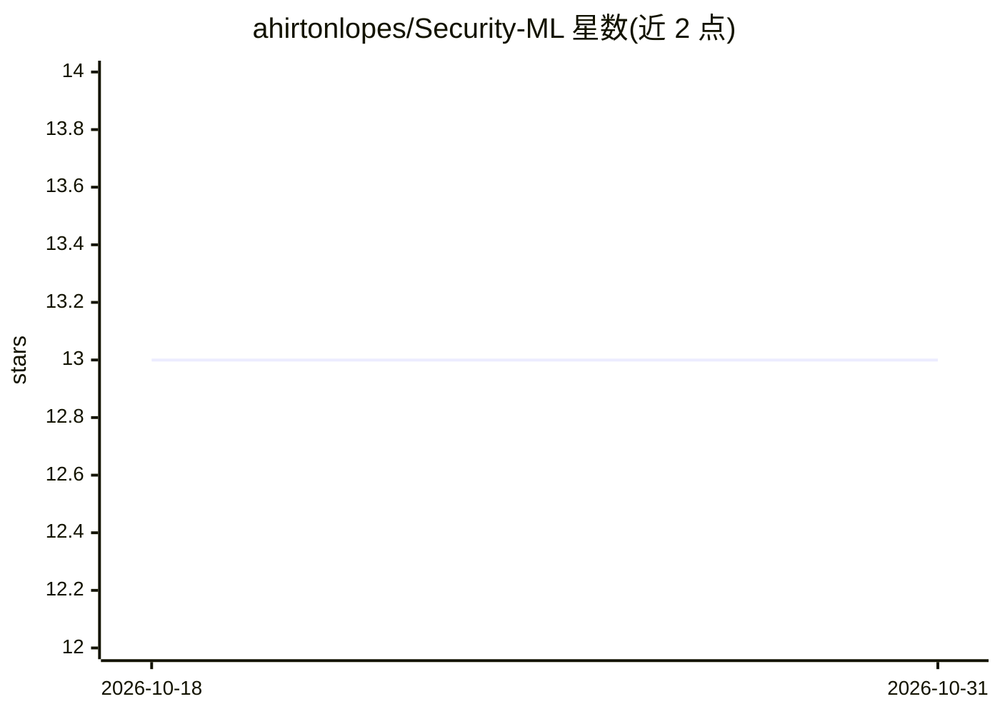

# ahirtonlopes/Security-ML

⭐ 13 · Jupyter Notebook · 推送 2026-02-25 · [GitHub](https://github.com/ahirtonlopes/Security-ML) · 组织维护

**FIAP 网络安全 MBA 的 AI/ML 课程材料与示例仓库**

FIAP 网络安全 MBA 课程 'Artificial Intelligence for Security' 的配套仓库，包含葡语课程讲义（Google Drive 的 ppt. 链接）与 Jupyter notebook 示例代码。主题覆盖异常检测、威胁分析、监督/无监督学习、神经网络与深度学习分析攻击、transformers 与 LLM 用于日志分析、生产环境模型部署等。使用方式为 git clone 后浏览 Aula_Extras/ 目录中的 notebook。

## 筛选速览

| 维度 | 判定 | 备注 |
|---|---|---|
| AI 角色 | `ai-knowledge` | 知识聚合/清单类 |
| 许可风险 | `none` | — |
| 部署形态 | `None` |  |
| 模型依赖 | — | README 未给出锁定关系 |
| 硬件要求 | — | 无带数字的原话,不猜 |
| 安装摩擦 | `low` | 无编译、无系统依赖或容器化 |
| 成熟度 | — | 结构信号不足 |

## 能力要点

- 课程讲义以 ppt. 形式托管于 Google Drive
- Aula_Extras/ 目录提供实践示例 notebook
- 主题涵盖异常检测、深度学习攻击分析与 LLM 日志分析

## 适用场景

- 系统学习 ML 在网络安全中的应用
- 获取威胁检测与异常分析的实践示例代码
- 作为安全方向 ML 课程的参考资料

## 场景标签

`网络安全` `教程课程` · 领域:学习与行业

## 证据(README 行号)

> L3: Slides and examples from our "Artificial Intelligence for Security" course @ FIAP
> L7: Este repositório contém materiais, códigos e recursos utilizados nas aulas de Inteligência Artificial e Machine Lear

## 星数曲线

2026-10-18 13 → 2026-10-31 13（+0）

---
*卡片 v1 · prompt 1.4 · 生成 2026-10-31 · 置信度 high · 依据 README sha `5affff666cb9` · [字段定义](../../DATASET.md)*
