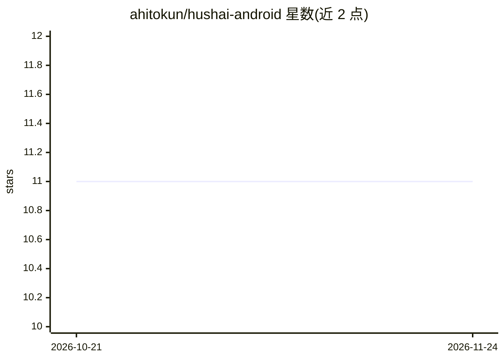

# ahitokun/hushai-android

⭐ 11 · Kotlin · Apache-2.0 · 推送 2026-05-11 · [GitHub](https://github.com/ahitokun/hushai-android) · 个人维护

**Android 离线端侧 AI 助手，本地运行 Qwen3 模型**

面向 Android 与 Windows 的端侧 AI 助手应用：通过自定义 JNI bridge 本地运行 Qwen3.5 系列模型，按设备内存分三档模型（0.8B/2B/4B 移动端，2B/4B/9B 桌面端）并自动选型。功能包括流式对话、任意应用文本分享求助、智能操作（撰写邮件、添加日历）、PDF/Word/CSV/代码文件读取、移动端扫描件 OCR、本地会话历史与 200+ 语言支持。首次下载模型后完全离线运行，无服务器、无账号、无数据收集。

## 筛选速览

| 维度 | 判定 | 备注 |
|---|---|---|
| AI 角色 | `ai-native` | 本体是模型或模型工具 |
| 许可风险 | `permissive` | Apache-2.0 |
| 部署形态 | `library` | 以包/库形式分发 |
| 模型依赖 | — | README 未给出锁定关系 |
| 硬件要求 | — | 无带数字的原话,不猜 |
| 安装摩擦 | `low` | 无编译、无系统依赖或容器化 |
| 成熟度 | — | 结构信号不足 |

## 能力要点

- 通过自定义 JNI bridge 在 Android 本地运行 Qwen3.5
- 按设备 RAM 分三档模型并自动选择
- PDF/Word/CSV/代码文件端侧读取，移动端支持扫描件 OCR
- 200+ 语言支持，模型下载后完全离线运行

## 适用场景

- 无网络或注重隐私环境下在手机上使用 AI 对话
- 阅读 PDF/Word 文档并在端侧提问
- 从其他应用分享文本获得改写、起草等即时帮助

## 场景标签

`AI 助手` `OCR` · 领域:对话与助手

## 证据(README 行号)

> L3: Private AI that runs on your device. No cloud, no accounts, no data collection.
> L5: Works offline after a one-time model download. Reads PDFs, Word docs, and text files — all on-device.
> L15: Runs Qwen3.5 — Alibaba's latest open-source model family.

## 星数曲线

2026-10-21 11 → 2026-11-24 11（+0）

---
*卡片 v1 · prompt 1.4 · 生成 2026-11-19 · 置信度 high · 依据 README sha `76ba08bc186a` · [字段定义](../../DATASET.md)*
