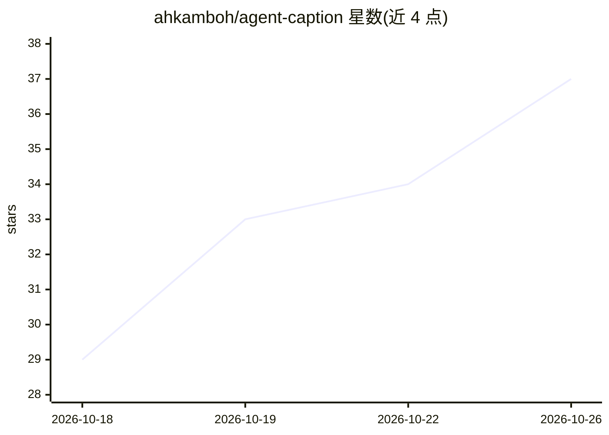

# ahkamboh/agent-caption

⭐ 37 · Python · MIT · 推送 2026-10-21 · [GitHub](https://github.com/ahkamboh/agent-caption) · [官网](https://ahkamboh.github.io/agent-caption/) · 个人维护

**本地离线给视频/歌曲加字幕的 Python CLI，支持 99 种语言**

用 Whisper 转写语音、whisperX/MMS 做逐词强制对齐，歌曲先用 Demucs 分离人声，再用 ffmpeg 把字幕烧录进视频，输出 .srt/.vtt 或 .captioned.mp4；内置 QA 校验与 footprint.svg 可视化。支持 Hinglish 混合语、15 种字幕样式、--script 用户提供文本模式。可通过 SKILL.md 交给 AI 编码代理执行，需 Python 3.10+、ffmpeg 与约 4GB 磁盘，模型由 setup.py 下载。MIT 许可。

## 筛选速览

| 维度 | 判定 | 备注 |
|---|---|---|
| AI 角色 | `ai-native` | 本体是模型或模型工具 |
| 许可风险 | `permissive` | MIT |
| 部署形态 | `None` |  |
| 模型依赖 | — | README 未给出锁定关系 |
| 硬件要求 | — | 无带数字的原话,不猜 |
| 安装摩擦 | `medium` | 含编译或系统依赖之一 |
| 成熟度 | — | 结构信号不足 |

## 能力要点

- Whisper 转写 + whisperX/MMS 逐词强制对齐（99/1100+ 语言）
- Demucs 人声分离，支持歌曲与 MV 歌词字幕
- 15 种内置字幕样式，可烧录或导出 SRT/VTT
- QA 校验输出 qa.json 与 footprint.svg 健康图

## 适用场景

- 给播客、访谈、课程视频生成带时间戳的字幕
- 制作 TikTok/Reels/Shorts 风格烧录字幕视频
- 给印地语-英语混合（Hinglish）内容加字幕
- 完全本地、不上传云端的隐私优先转写场景

## 场景标签

`语音识别` `图像视频处理` · 领域:感知与多模态

## 证据(README 行号)

> L116: 2. **Words** — Whisper transcribes the speech (or you supply them with `--script`).
> L118: 4. **Burn** — clean, proportional captions are rendered and overlaid → `*.captioned.mp4`.

## 星数曲线

2026-10-18 29 → 2026-10-26 37（+8）

---
*卡片 v1 · prompt 1.4 · 生成 2026-10-25 · 置信度 high · 依据 README sha `d867ed32d05b` · [字段定义](../../DATASET.md)*
