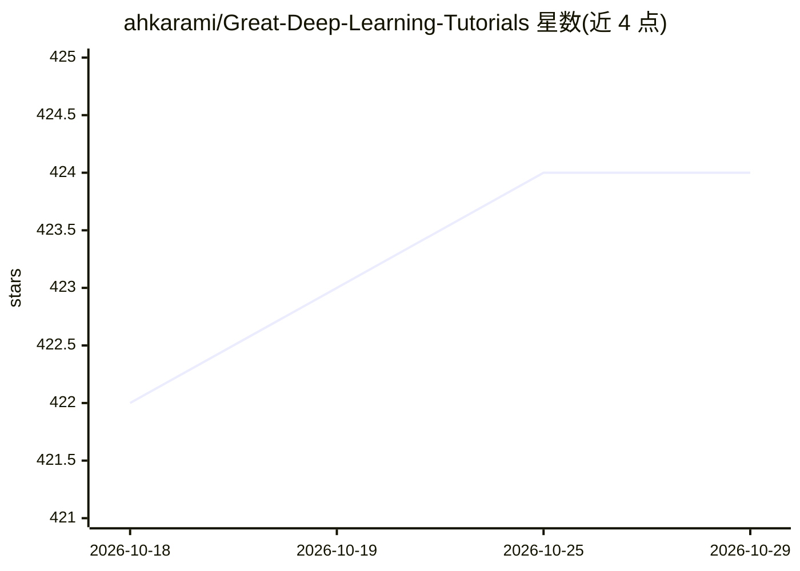

# ahkarami/Great-Deep-Learning-Tutorials

⭐ 424 · MIT · 推送 2026-06-21 · [GitHub](https://github.com/ahkarami/Great-Deep-Learning-Tutorials) · 个人维护

**深度学习教程与仓库的策展清单**

由个人维护的深度学习资源聚合清单：按通用教程、计算机视觉、NLP、语音处理、数据科学、量化与蒸馏、AutoML、扩散模型、多模态、深度强化学习、图神经网络等主题分类，收录课程、博客、论文解读与开源仓库链接；另含训练最佳实践（损失函数、学习率调度、早停）、框架与高层库、模型转换与标注工具等条目。条目为链接列举形式，不含可运行代码。

## 筛选速览

| 维度 | 判定 | 备注 |
|---|---|---|
| AI 角色 | `ai-knowledge` | 知识聚合/清单类 |
| 许可风险 | `permissive` | MIT |
| 部署形态 | `None` |  |
| 模型依赖 | — | README 未给出锁定关系 |
| 硬件要求 | — | 无带数字的原话,不猜 |
| 安装摩擦 | `low` | 无编译、无系统依赖或容器化 |
| 成熟度 | — | 结构信号不足 |

## 能力要点

- 按 20+ 主题分类组织教程与仓库链接
- 覆盖量化/蒸馏、深度强化学习、图神经网络等专题
- 收录 PyTorch 训练最佳实践与高层库条目
- 收录会议论文摘要与 State of AI 报告等跟踪资源

## 适用场景

- 按主题查找深度学习入门与进阶教程
- 查找特定方向（GNN、扩散模型、量化）的学习资源
- 了解常用训练库与工具的条目索引

## 场景标签

`教程课程` `精选清单` · 领域:学习与行业

## 证据(README 行号)

> L1: # Great-Deep-Learning-Tutorials
> L2: A Great Collection of Deep Learning Tutorials and Repositories
> L4: ## General Deep Learning Tutorials:

## 星数曲线

2026-10-18 422 → 2026-10-29 424（+2）

---
*卡片 v1 · prompt 1.4 · 生成 2026-10-21 · 置信度 high · 依据 README sha `0b9992d87d39` · [字段定义](../../DATASET.md)*
