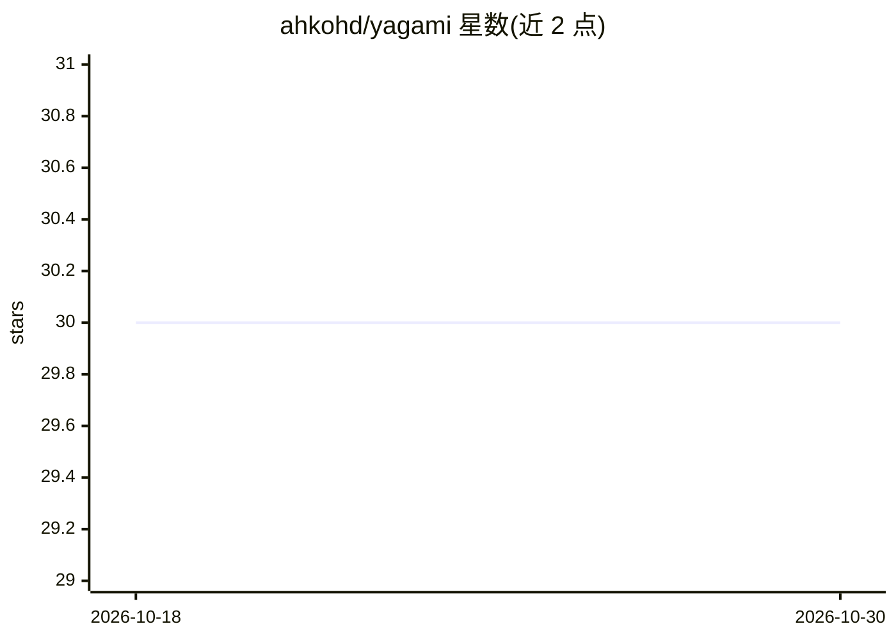

# ahkohd/yagami

⭐ 30 · TypeScript · MIT · 推送 2026-06-20 · [GitHub](https://github.com/ahkohd/yagami) · 个人维护

**本地优先的 Agentic 网络搜索代理（CLI + 本地 HTTP 守护进程）**

以 npm 全局安装的 CLI 工具，运行时启动本地 HTTP 守护进程（默认 127.0.0.1:43111），提供 agentic 网络搜索、代码/公司搜索、相似站点发现、确定性单页抽取（fetch）与异步深度研究等能力。LLM 通过 OpenAI-completions 或 anthropic-messages 兼容接口接入，README 列出 vLLM/SGLang/Ollama/LM Studio 等本地端点示例，默认无需 API key。另暴露 MCP over HTTP 端点与 Prometheus 格式的 /metrics 指标，搜索引擎默认 DuckDuckGo，可配置 Bing/Google/Brave/自定义模板。

## 筛选速览

| 维度 | 判定 | 备注 |
|---|---|---|
| AI 角色 | `ai-native` | 本体是模型或模型工具 |
| 许可风险 | `permissive` | MIT |
| 部署形态 | `library` | 以包/库形式分发 |
| 模型依赖 | local-ok | 支持本地模型 |
| 硬件要求 | — | 无带数字的原话,不猜 |
| 安装摩擦 | `low` | 无编译、无系统依赖或容器化 |
| 成熟度 | — | 结构信号不足 |

## 能力要点

- search/search-advanced/code/company/similar 等多类 agentic 搜索命令
- 本地 HTTP 守护进程 + HTTP API + MCP over HTTP（JSON-RPC）
- 兼容 vLLM/SGLang/Ollama/LM Studio 本地 LLM 端点，API key 默认为空
- Prometheus 格式 /metrics 暴露查询、缓存、并发与 token 用量指标

## 适用场景

- 在本地跑一个 agentic 网络搜索服务，供 CLI 或 HTTP/MCP 调用
- 为 agent 框架通过 MCP 接入网络搜索与网页抽取工具
- 用本地 LLM 端点执行代码/公司/相似站点调研与深度研究任务

## 场景标签

`科研工具` `网页抓取` · 领域:效率与自动化

## 证据(README 行号)

> L7: Local-first web search agent
> L156: - `llmApi` (`openai-completions` | `anthropic-messages`, default: `openai-completions`)

## 星数曲线

2026-10-18 30 → 2026-10-30 30（+0）

---
*卡片 v1 · prompt 1.4 · 生成 2026-10-26 · 置信度 high · 依据 README sha `726816aa569d` · [字段定义](../../DATASET.md)*
