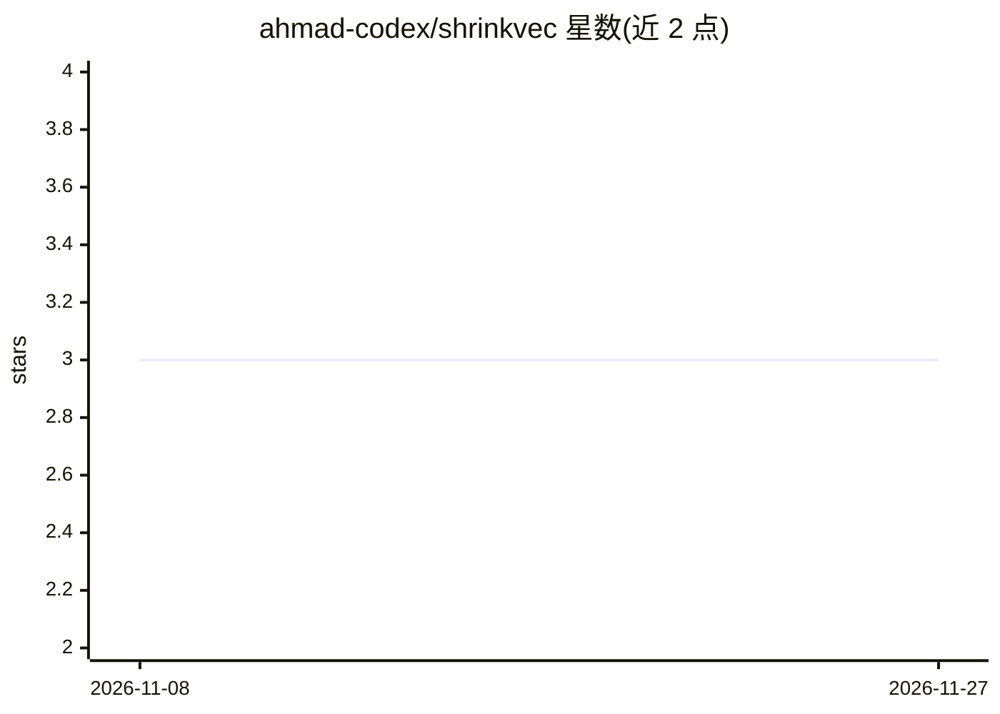

# ahmad-codex/shrinkvec

⭐ 3 · Python · MIT · 推送 2026-11-01 · [GitHub](https://github.com/ahmad-codex/shrinkvec) · [官网](https://github.com/ahmad-codex/shrinkvec/releases/latest) · 个人维护

**向量压缩基准评测工具：在你的数据上量测召回并给出建索引 SQL**

shrinkvec 在用户自己的向量数据上逐一评测多种嵌入压缩选项（halfvec、binary、int8、RaBitQ、TurboQuant 及多级 rerank 流水线），直接在用户的 Postgres 中构建真实索引，扫搜参数并记录 recall@10、p50/p95 延迟、磁盘占用与建索引耗时，最终推荐满足 --target 召回的最小索引并输出对应 SQL。无数据库时也支持从 .npy/.fvecs/.parquet 文件评测 codec，另提供退出码可接 CI 的召回阈值检查。安装方式为 pip（Python 3.10+），并提供一键 docker demo。

## 筛选速览

| 维度 | 判定 | 备注 |
|---|---|---|
| AI 角色 | `ai-ecosystem` | LLM/agent 周边工具 |
| 许可风险 | `permissive` | MIT |
| 部署形态 | `self-host` | docker 或自建部署 |
| 模型依赖 | — | README 未给出锁定关系 |
| 硬件要求 | — | 无带数字的原话,不猜 |
| 安装摩擦 | `low` | 无编译、无系统依赖或容器化 |
| 成熟度 | — | 结构信号不足 |

## 能力要点

- 对 13 种压缩选项在用户自有向量上计算 exact ground truth 召回
- 在用户 Postgres 内构建真实索引（pgvector HNSW、VectorChord vchordrq），不写入用户表
- 推荐满足召回目标的最小索引并生成 CREATE INDEX/SET/查询 SQL
- 输出自包含 report.html、results.md 与 results.json，可作 CI 召回下限门禁

## 适用场景

- 评估 RAG 向量列用哪种量化压缩能省空间且召回达标
- 嵌入模型更换后检查压缩方案的召回是否下降
- 在无数据库环境下离线评测向量文件的 codec 召回

## 场景标签

`模型评测` `模型量化` · 领域:评测与运维

## 证据(README 行号)

> L8: **How small can your embeddings get before search gets worse?** shrinkvec measures every
> L9: compression option on *your* vectors, builds the real indexes in *your* Postgres, and tells you the
> L47:  setting and records recall, p50/p95 latency, size on disk and build time.

## 星数曲线

2026-11-08 3 → 2026-11-27 3（+0）

---
*卡片 v1 · prompt 1.4 · 生成 2026-11-22 · 置信度 high · 依据 README sha `65400957d378` · [字段定义](../../DATASET.md)*
