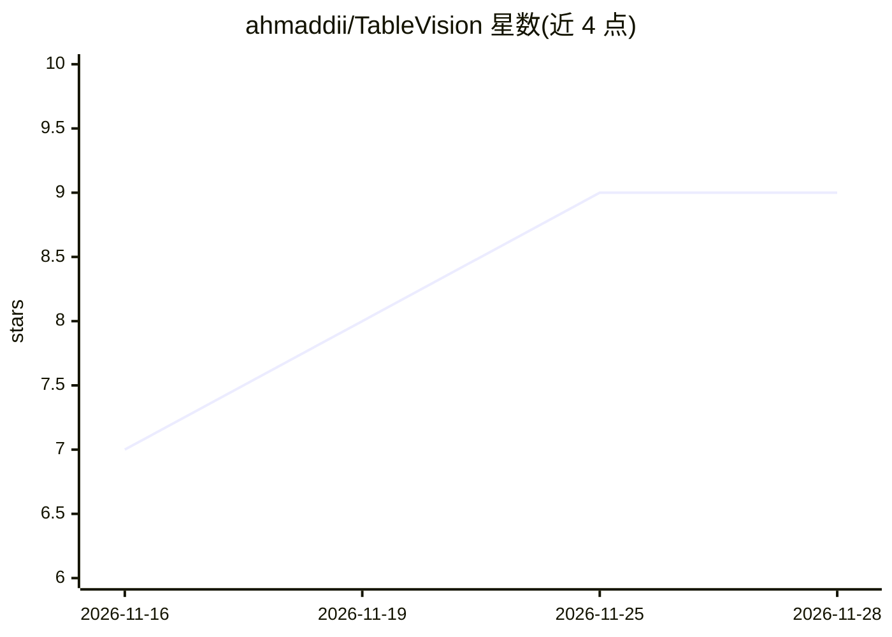

# ahmaddii/TableVision

⭐ 9 · Python · 推送 2026-11-16 · [GitHub](https://github.com/ahmaddii/TableVision) · 个人维护

**餐厅 CCTV 视频的餐台占用检测原型**

计算机视觉原型：读取餐厅已有 CCTV 视频，用 YOLO26 Pose 检测人体姿态，ByteTrack 做跨帧多目标跟踪，按手绘的多边形餐台区域结合邻近度、姿态（坐/站）、移动历史与确认/离开计时器四种信号，判定每个餐台为空闲/评估中/占用并估算客人数，导出带标注的视频。README 声明为实验性原型，占用与人数为估计值，遮挡、相机角度与光线会影响准确性；当前仅处理视频文件，实时流与多相机在 Roadmap 中。

## 筛选速览

| 维度 | 判定 | 备注 |
|---|---|---|
| AI 角色 | `ai-native` | 本体是模型或模型工具 |
| 许可风险 | `none` | — |
| 部署形态 | `None` |  |
| 模型依赖 | — | README 未给出锁定关系 |
| 硬件要求 | — | 无带数字的原话,不猜 |
| 安装摩擦 | `medium` | 含编译或系统依赖之一 |
| 成熟度 | — | 结构信号不足 |

## 能力要点

- YOLO26 Pose 人体姿态检测 + ByteTrack 跨帧跟踪
- 手绘多边形定义餐台区域，支持逐相机视图配置
- 四种信号组合判定占用状态，含确认/离开计时器过滤误判
- 员工过滤与走道忽略区域

## 适用场景

- 从餐厅现有 CCTV 视频生成餐台空闲/占用状态
- 餐饮科技场景下评估视觉占用检测方案的可行性
- 需要估算餐桌客人数的运营分析原型

## 场景标签

`目标检测` · 领域:感知与多模态

## 证据(README 行号)

> L27: Most restaurants already have CCTV. **TableVision** is a computer vision prototype that analyzes that footage to de
> L36: |🧍|**Pose detection**|People and body pose via YOLO26 Pose|

## 星数曲线

2026-11-16 7 → 2026-11-28 9（+2）

---
*卡片 v1 · prompt 1.4 · 生成 2026-11-20 · 置信度 high · 依据 README sha `1f83515632f8` · [字段定义](../../DATASET.md)*
