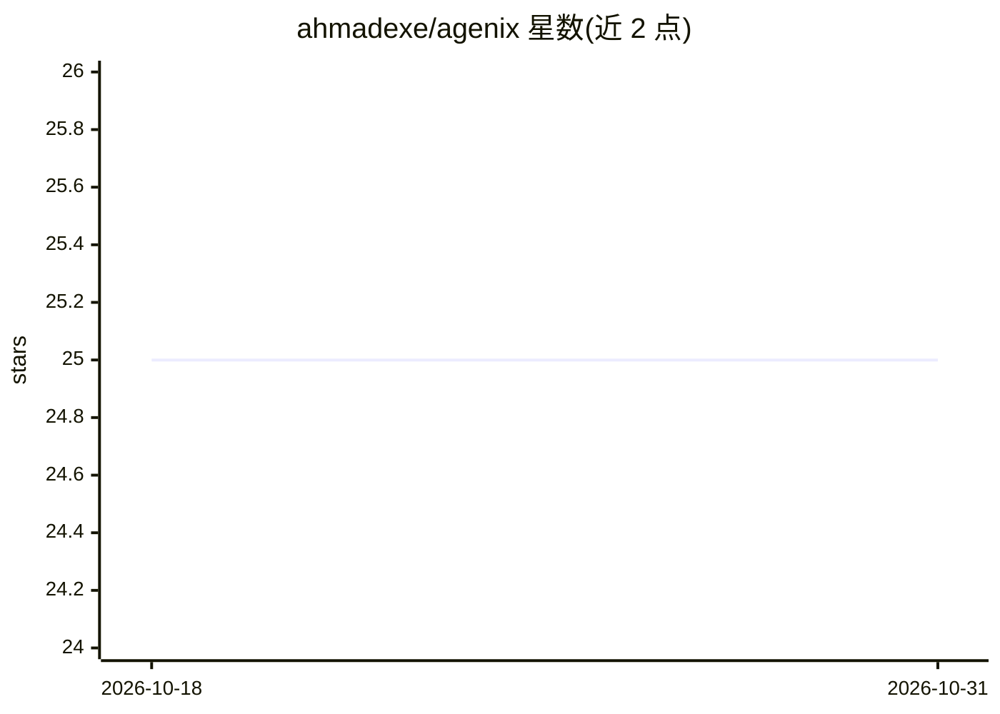

# ahmadexe/agenix

⭐ 25 · Dart · MIT · 推送 2026-07-02 · [GitHub](https://github.com/ahmadexe/agenix) · [官网](https://pub.dev/packages/agenix) · 个人维护

**Flutter 多智能体编排框架：构建带记忆、工具与链式协作的 AI agent**

面向 Flutter 开发者的 AI agent 构建包（monorepo，含核心包与 Firebase 后端包）。核心 Agent 类组装 LLM、DataStore、ToolRegistry 与 AgentScope；内置 8 家 LLM 提供商适配器（Gemini/OpenAI/Anthropic/Groq/Mistral/DeepSeek/xAI/Cohere），支持自定义 LLM 与 DataStore 实现。Agent 可调用工具（每轮最多 5 次迭代）、在链上把子任务委派给多个专门 agent（链深上限 5，含环检测）；对话持久化默认内存实现，生产环境用可选的 Firebase 包。

## 筛选速览

| 维度 | 判定 | 备注 |
|---|---|---|
| AI 角色 | `ai-ecosystem` | LLM/agent 周边工具 |
| 许可风险 | `permissive` | MIT |
| 部署形态 | `None` |  |
| 模型依赖 | locked-api |  |
| 硬件要求 | — | 无带数字的原话,不猜 |
| 安装摩擦 | `low` | 无编译、无系统依赖或容器化 |
| 成熟度 | — | 结构信号不足 |

## 能力要点

- 8 家 LLM 提供商内置适配器并支持自定义实现
- 多 agent 链式委派（环检测、深度上限 5）
- 工具调用最多 5 轮迭代，ToolResponse 支持结构化数据与二次推理
- 内存/Firebase 双数据存储，接口可自定义（如 Postgres）

## 适用场景

- 在 Flutter 应用里做单 agent 聊天或问答应用
- 让 agent 调用外部 API 工具获取实时数据
- 编排多个专门 agent 协作处理复合任务
- 用 Firebase 持久化对话并做多租户/多用户隔离

## 场景标签

`Agent 框架` `多智能体` · 领域:Agent 开发

## 证据(README 行号)

> L11: A Flutter package for building AI agents with memory, tools, and multi-agent orchestration. Define your agent's per
> L174: The `LLM` abstract class defines the contract for language model providers. Agenix ships with built-in adapters fo
> L276: When the LLM determines a task requires multiple specialists, it returns an `agents_chain`. Agenix automatically d

## 星数曲线

2026-10-18 25 → 2026-10-31 25（+0）

---
*卡片 v1 · prompt 1.4 · 生成 2026-10-27 · 置信度 high · 依据 README sha `81943c40e7f4` · [字段定义](../../DATASET.md)*
