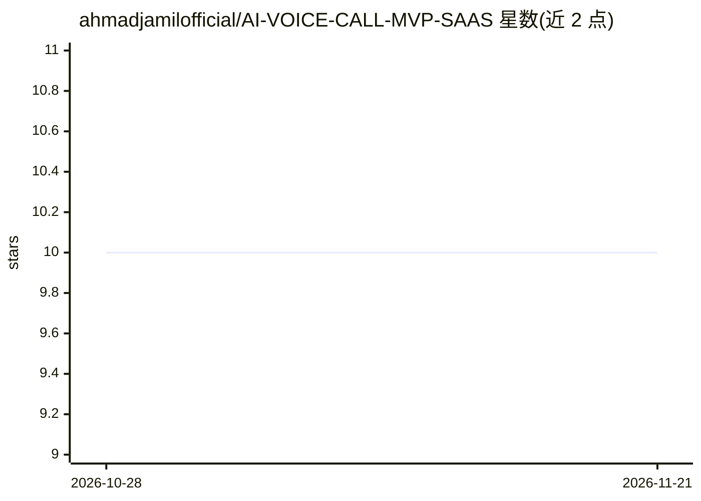

# ahmadjamilofficial/AI-VOICE-CALL-MVP-SAAS

⭐ 10 · TypeScript · 推送 2026-04-14 · [GitHub](https://github.com/ahmadjamilofficial/AI-VOICE-CALL-MVP-SAAS) · [官网](https://callbot-voice-ai.vercel.app) · 个人维护

**给呼叫中心场景的 AI 电话通话 SaaS MVP**

基于 React、Twilio、Gemini 与 Supabase 构建的电话通话 SaaS 平台：通过 Twilio 集成电话号码与通话管理，由 Gemini 生成对话并处理实时通话流程，覆盖从开场到结束的完整通话环节，提供认证、实时日志、通话转录及带分析功能的仪表盘。README 提供 git clone 与 npm 安装运行步骤，支持部署到 Vercel 或 Netlify，采用 MIT 许可。

## 筛选速览

| 维度 | 判定 | 备注 |
|---|---|---|
| AI 角色 | `ai-native` | 本体是模型或模型工具 |
| 许可风险 | `none` | — |
| 部署形态 | `library` | 以包/库形式分发 |
| 模型依赖 | — | README 未给出锁定关系 |
| 硬件要求 | — | 无带数字的原话,不猜 |
| 安装摩擦 | `low` | 无编译、无系统依赖或容器化 |
| 成熟度 | — | 结构信号不足 |

## 能力要点

- Twilio 电话号码集成与通话管理
- Gemini 生成对话并处理实时通话流程
- 实时日志与通话转录
- 带用户分析、通话历史的 SaaS 仪表盘

## 适用场景

- 用 AI 自动接听和管理来电
- 查看通话记录与实时转录
- 搭建多用户电话 AI 呼叫服务

## 场景标签

`语音 Agent` · 领域:对话与助手

## 证据(README 行号)

> L3: CallBot AI is a fully functional SaaS (Software as a Service) platform that enables users to automate and manage the
> L13: - **Gemini** – For generating human-like AI conversations and handling real-time call flow.

## 星数曲线

2026-10-28 10 → 2026-11-21 10（+0）

---
*卡片 v1 · prompt 1.4 · 生成 2026-11-20 · 置信度 high · 依据 README sha `3ee84a3ba9f2` · [字段定义](../../DATASET.md)*
