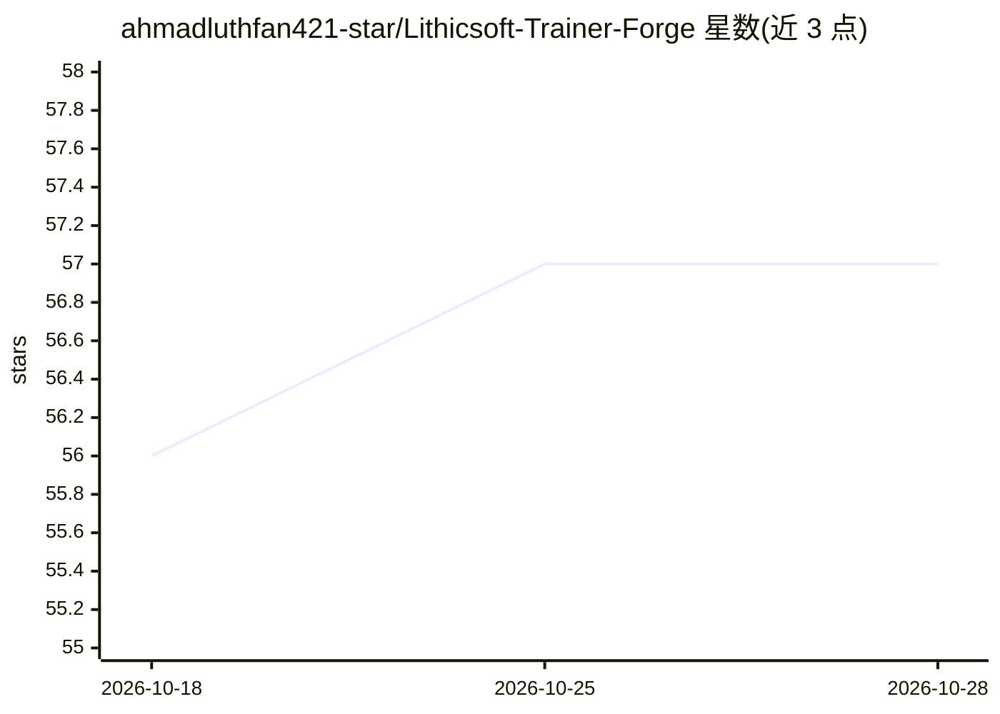

# ahmadluthfan421-star/Lithicsoft-Trainer-Forge

⭐ 57 · HTML · 推送 2026-10-27 · [GitHub](https://github.com/ahmadluthfan421-star/Lithicsoft-Trainer-Forge) · 个人维护

**构建与发布自适应教学训练模块的 Python 工具集**

Lithicsoft Trainer Studio 生态的配套 Python 工具包（内部简称 ATIF）：以声明式蓝图描述训练模块（课程、评分策略、调度策略），通过 8 阶段确定性流水线（草稿、规范化、蓝图绑定、本地化抽取、沙箱演练、审查门、发布组装、分发）生成带清单与校验和的便携发布包；提供合成学员队列的沙箱演练、课程生命周期管理与本地渲染的洞察面板。面向教育者、产品团队与二次开发者，需配合 Trainer Studio 生态使用。

## 筛选速览

| 维度 | 判定 | 备注 |
|---|---|---|
| AI 角色 | `ai-enhanced` | 去掉 AI 部分产品仍成立 |
| 许可风险 | `none` | — |
| 部署形态 | `None` |  |
| 模型依赖 | — | README 未给出锁定关系 |
| 硬件要求 | — | 无带数字的原话,不猜 |
| 安装摩擦 | `low` | 无编译、无系统依赖或容器化 |
| 成熟度 | — | 结构信号不足 |

## 能力要点

- 声明式蓝图描述训练模块，支持局部替换评分/调度组件
- 8 阶段发布流水线，每阶段留有可追溯记录
- 合成学员队列沙箱演练环境
- 便携发布包含清单、校验和与纯文本变更日志

## 适用场景

- 组装、版本化并分发自己的训练课程模块
- 在真实学员上线前用合成队列演练调试评分规则
- 管理课程从草稿到发布的生命周期与多语言本地化

## 场景标签

 · 领域:教育软件/教学内容工具

## 证据(README 行号)

> L25: The **Lithicsoft Trainer Studio — Adaptive Instruction Foundry** (internally abbreviated as *ATIF*) is a Python-fir
> L74: If you arrived here by searching for an **open-source Python trainer toolkit**, an **adaptive learning content pipe

## 星数曲线

2026-10-18 56 → 2026-10-28 57（+1）

---
*卡片 v1 · prompt 1.4 · 生成 2026-10-24 · 置信度 mid · 依据 README sha `18271a1203e8` · [字段定义](../../DATASET.md)*
