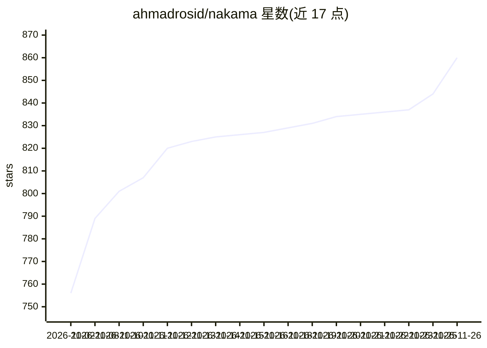

# ahmadrosid/nakama

⭐ 860 · TypeScript · MIT · 推送 2026-11-25 · [GitHub](https://github.com/ahmadrosid/nakama) · [官网](https://ahmadrosid.github.io/nakama) · 个人维护

**团队共享 AI agent 的平台：集中托管代理、技能与自动化**

Nakama 是一个面向团队的 AI agent 平台，提供类 ChatGPT 的对话仪表盘，每个 agent 可配置系统提示、SOUL/STYLE/INSTRUCTIONS/MEMORY 文件、工具、技能、MCP 与权限，agent 之间相互隔离。支持 Telegram、WhatsApp、Discord、Slack 渠道接入，经 Composio 可连接超过 1,000 个外部应用。多组织、邀请与角色管理，可用云托管服务或单容器 Docker 自托管运行。

## 筛选速览

| 维度 | 判定 | 备注 |
|---|---|---|
| AI 角色 | `ai-native` | 本体是模型或模型工具 |
| 许可风险 | `permissive` | MIT |
| 部署形态 | `self-host` | docker 或自建部署 |
| 模型依赖 | — | README 未给出锁定关系 |
| 硬件要求 | — | 无带数字的原话,不猜 |
| 安装摩擦 | `low` | 无编译、无系统依赖或容器化 |
| 成熟度 | — | 结构信号不足 |

## 能力要点

- 每个 agent 具备独立提示文件、工具、技能、记忆与权限
- 接入 Telegram/WhatsApp/Discord/Slack 渠道，经 Composio 连接 1,000+ 外部应用
- 多组织与角色管理，agent 相互隔离
- 提供云托管、Bun 本地运行、PM2 部署与 Docker Compose 多种运行方式

## 适用场景

- 为团队搭建统一的 agent 工作台并按角色分配权限
- 让 agent 通过 Telegram/Slack 等渠道响应团队消息
- 用单容器 Docker 在服务器上自托管 agent 平台
- 通过 Composio 让 agent 操作外部 SaaS 应用

## 场景标签

`聊天机器人` `AI 助手` `工作流自动化` · 领域:效率与自动化

## 证据(README 行号)

> L24: Nakama is an AI agent platform for your team. You chat in a dashboard that feels like ChatGPT. Behind that, each ag
> L26: It was built for teams from day one: one server, many orgs, invites and roles, agents isolated from each other. Set

## 星数曲线

2026-11-02 756 → 2026-11-26 860（+104）

---
*卡片 v1 · prompt 1.4 · 生成 2026-11-24 · 置信度 low · 依据 README sha `4640da199791` · [字段定义](../../DATASET.md)*
