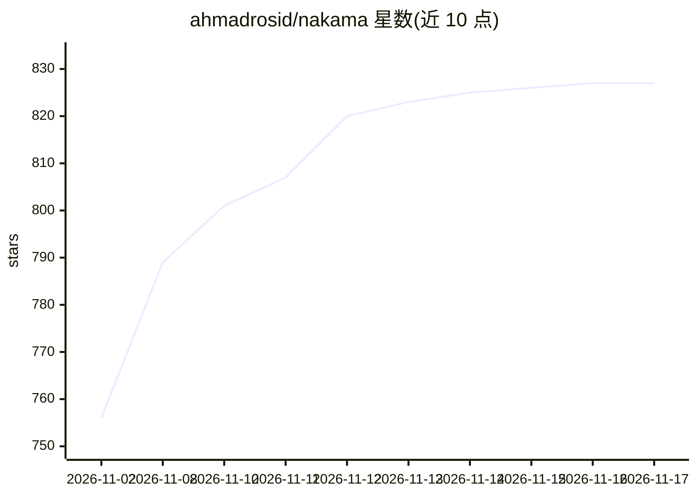

# ahmadrosid/nakama

⭐ 827 · TypeScript · MIT · 推送 2026-11-15 · [GitHub](https://github.com/ahmadrosid/nakama) · [官网](https://ahmadrosid.github.io/nakama) · 个人维护

**团队共享的 AI agent 平台：聊天界面运行多代理**

自托管的 AI agent 平台：通过类 ChatGPT 的 Web 仪表盘与 agent 对话，每个 agent 拥有独立的 prompt 文件、工具、技能、记忆与频道接入（Telegram、WhatsApp、Discord、Slack），并可经 Composio 连接上千个外部应用。面向团队多组织设计：单服务器、多 org、邀请与角色、agent 相互隔离。部署方式含托管云、Bun 本地开发、PM2 裸机与单容器 Docker/Compose（约 200MB 空闲内存、1vCPU/1GB 可运行）。macOS 有桌面下载，Windows 暂无发布安装链接。

## 筛选速览

| 维度 | 判定 | 备注 |
|---|---|---|
| AI 角色 | `ai-ecosystem` | LLM/agent 周边工具 |
| 许可风险 | `permissive` | MIT |
| 部署形态 | `self-host` | docker 或自建部署 |
| 模型依赖 | — | README 未给出锁定关系 |
| 硬件要求 | — | 无带数字的原话,不猜 |
| 安装摩擦 | `low` | 无编译、无系统依赖或容器化 |
| 成熟度 | — | 结构信号不足 |

## 能力要点

- 每 agent 独立的 prompt 文件、工具、技能、记忆与权限
- 接入 Telegram/WhatsApp/Discord/Slack 频道与 Composio 千余外部应用
- 多组织/角色/邀请的团队架构，agent 相互隔离
- 单容器 Docker 部署，空载约 200MB 内存

## 适用场景

- 团队在统一仪表盘中运行和共享多个 AI agent
- 把 agent 接入 Telegram/Slack 等聊天频道执行自动化
- 私有部署一套带权限隔离的公司级 agent 工作区

## 场景标签

`聊天机器人` `多智能体` `工作流自动化` · 领域:Agent 开发

## 证据(README 行号)

> L25: Nakama is an AI agent platform for your team. You chat in a dashboard that feels like ChatGPT. Behind that, each ag
> L27: It was built for teams from day one: one server, many orgs, invites and roles, agents isolated from each other. Set

## 星数曲线

2026-11-02 756 → 2026-11-17 827（+71）

---
*卡片 v1 · prompt 1.4 · 生成 2026-11-17 · 置信度 mid · 依据 README sha `5c8d159e3a5c` · [字段定义](../../DATASET.md)*
