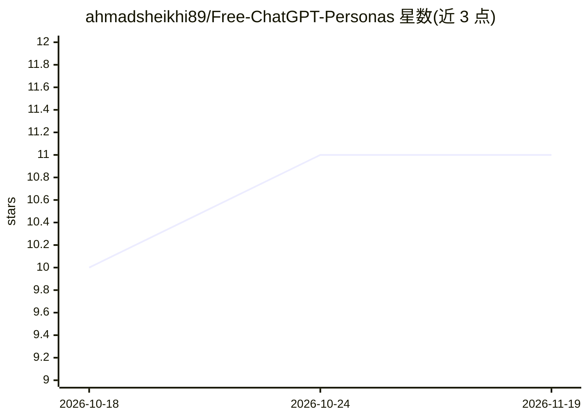

# ahmadsheikhi89/Free-ChatGPT-Personas

⭐ 11 · MIT · 推送 2026-04-29 · [GitHub](https://github.com/ahmadsheikhi89/Free-ChatGPT-Personas) · [官网](https://opspro.ir) · 个人维护

**面向 ChatGPT 用户的 8 种角色 Custom instructions 模板集**

为 ChatGPT 的 Personalization / Custom instructions 页面提供可直接复制粘贴的模板集合，覆盖 DevOps/SRE、软件开发、内容创作、语言教师、学科教师、学生备考、求职面试、小企业主 8 类角色。每个模板包含 Base style and tone、Custom instructions、Nickname、Occupation、More about you 五个字段，用户替换 <PLACEHOLDER> 后填入 ChatGPT 设置即可使用，无需安装或代码，面向 ChatGPT 免费版用户设计。

## 筛选速览

| 维度 | 判定 | 备注 |
|---|---|---|
| AI 角色 | `ai-knowledge` | 知识聚合/清单类 |
| 许可风险 | `permissive` | MIT |
| 部署形态 | `None` |  |
| 模型依赖 | — | README 未给出锁定关系 |
| 硬件要求 | — | 无带数字的原话,不猜 |
| 安装摩擦 | `low` | 无编译、无系统依赖或容器化 |
| 成熟度 | — | 结构信号不足 |

## 能力要点

- 8 类角色的 Custom instructions 复制粘贴模板
- 统一五字段结构：风格下拉、指令文本、昵称、职业、个人简介
- 兼容免费版仅有一个 Custom instructions 输入框的情况
- 提供模板调整建议（语气、约束、多角色组合）

## 适用场景

- 让 ChatGPT 按 DevOps 或开发者角色持续给出专业回答
- 教师和学生用模板配置辅导式学习助手
- 求职者用 Career 模板改简历和面试练习

## 场景标签

`提示工程` · 领域:Agent 开发

## 证据(README 行号)

> L27: This repository gives you **ready-to-use templates** for the
> L29: even on the **free tier**.
> L134: ## 📚 Personas overview

## 星数曲线

2026-10-18 10 → 2026-11-19 11（+1）

---
*卡片 v1 · prompt 1.4 · 生成 2026-11-18 · 置信度 high · 依据 README sha `d9ea158416bb` · [字段定义](../../DATASET.md)*
