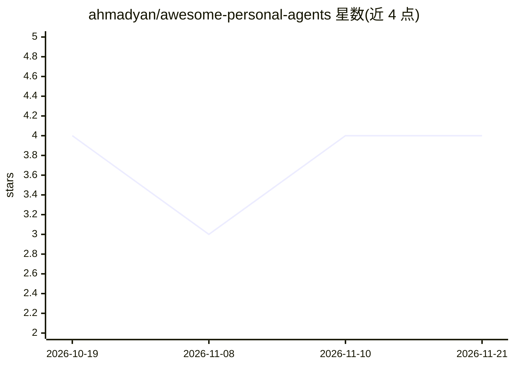

# ahmadyan/awesome-personal-agents

⭐ 4 · CC0-1.0 · 推送 2026-10-06 · [GitHub](https://github.com/ahmadyan/awesome-personal-agents) · [官网](https://www.agentastic.com) · 个人维护

**常驻个人 AI Agent 及记忆层、运行时、消息桥的策展清单**

按字母序组织的 awesome 清单，收录常驻个人 AI Agent 生态：自托管与托管 Agent、记忆层库、运行时与沙箱、消息桥接库（WhatsApp/iMessage/Telegram 等）、客户端启动器、工具集成与背景阅读材料。每条条目附一句话说明与开源许可证标注，Mac 专属工具单独标记。清单本身不提供安装命令或运行功能，仅做条目组织与收录。

## 筛选速览

| 维度 | 判定 | 备注 |
|---|---|---|
| AI 角色 | `ai-knowledge` | 知识聚合/清单类 |
| 许可风险 | `viral` | CC0-1.0 |
| 部署形态 | `None` |  |
| 模型依赖 | — | README 未给出锁定关系 |
| 硬件要求 | — | 无带数字的原话,不猜 |
| 安装摩擦 | `low` | 无编译、无系统依赖或容器化 |
| 成熟度 | — | 结构信号不足 |

## 能力要点

- 五个板块：自托管/托管 Agent、记忆层、运行时沙箱、消息桥、客户端
- 条目标注开源许可证与 Proprietary 属性
- 收录 MCP、消息桥接库等构建组件
- 附记忆与安全相关的论文和阅读清单

## 适用场景

- 为自托管个人 Agent 选型时查找候选项目
- 给 Agent 添加长期记忆时比较记忆层库
- 把 Agent 接入 WhatsApp/iMessage 等聊天渠道时找桥接方案

## 场景标签

`精选清单` · 领域:学习与行业

## 证据(README 行号)

> L3: > A curated list of always-on personal AI agents and the memory layers, runtimes, and messaging bridges they are bui
> L5: A personal agent remembers you, keeps running when you are not looking, and acts for you across chat, files, and too

## 星数曲线

2026-10-19 4 → 2026-11-21 4（+0）

---
*卡片 v1 · prompt 1.4 · 生成 2026-11-21 · 置信度 high · 依据 README sha `2f7247eba1c8` · [字段定义](../../DATASET.md)*
