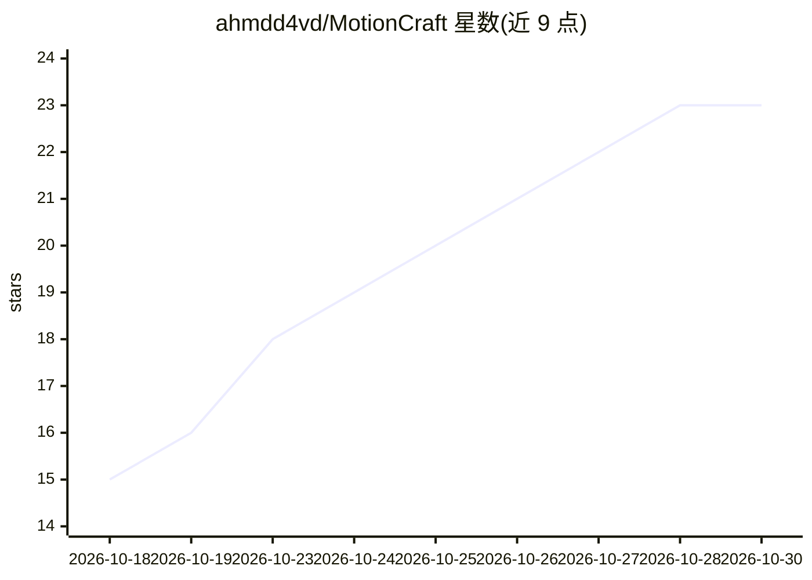

# ahmdd4vd/MotionCraft

⭐ 23 · JavaScript · MIT · 推送 2026-09-26 · [GitHub](https://github.com/ahmdd4vd/MotionCraft) · 个人维护

**让 AI agent 用 Remotion 生成动效解说视频的 Agent Skill**

以 Agent Skill 形式分发的视频制作工作流：装到支持 Agent Skills 的编码代理（Claude Code、Codex、Cursor 等）后，用户给出主题或参考视频，agent 按 brief→research→script→voice→music→build→QA→render 循环产出成片。机制上基于 Remotion 模板、5 种锁定风格、本机合成的音乐音效、Whisper 词级时间戳对齐配音，并提供独立 CLI 与像素/重叠 QA 采样。要求 Node.js 18+，Remotion 按项目安装；Remotion 本身有独立许可条款。

## 筛选速览

| 维度 | 判定 | 备注 |
|---|---|---|
| AI 角色 | `ai-ecosystem` | LLM/agent 周边工具 |
| 许可风险 | `permissive` | MIT |
| 部署形态 | `library` | 以包/库形式分发 |
| 模型依赖 | — | README 未给出锁定关系 |
| 硬件要求 | — | 无带数字的原话,不猜 |
| 安装摩擦 | `low` | 无编译、无系统依赖或容器化 |
| 成熟度 | — | 结构信号不足 |

## 能力要点

- npx 一条命令安装到任意支持 Agent Skills 的代理
- 词级配音同步（faster-whisper）与本机合成音乐/16 种音效
- 5 种锁定风格 + 3D 相机/材质光照/节拍对齐（v0.5）
- 独立 CLI：storyboard/preview/QA/render 全流程可用

## 适用场景

- 让 AI agent 从主题直接产出带配音的解说视频
- 仿照喜欢的视频风格制作同类内容
- 多尺寸导出到 WhatsApp/Instagram/YouTube 等平台

## 场景标签

`视频生成` · 领域:内容生成

## 证据(README 行号)

> L56: Works with any AI agent that supports Agent Skills - Claude Code, Codex, Cursor, Gemini CLI, Pi, Hermes Agent and m
> L5: Give your agent a topic (or a video you like). It researches, writes the script, times every word to the voice, make
> L87:   SKILL.md          the workflow your agent follows

## 星数曲线

2026-10-18 15 → 2026-10-30 23（+8）

---
*卡片 v1 · prompt 1.4 · 生成 2026-10-27 · 置信度 high · 依据 README sha `f99e147aee45` · [字段定义](../../DATASET.md)*
