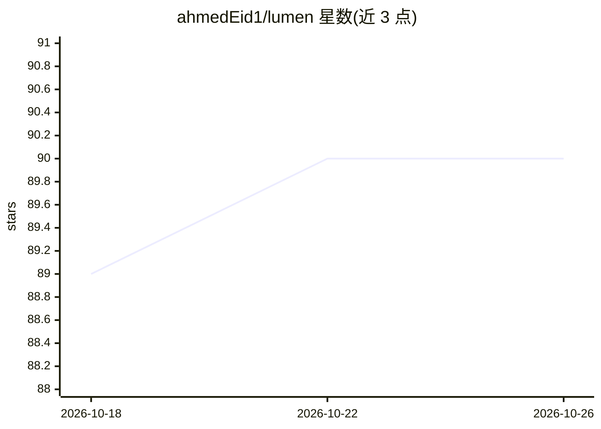

# ahmedEid1/lumen

⭐ 90 · Python · GPL-3.0 · 推送 2026-06-07 · [GitHub](https://github.com/ahmedEid1/lumen) · [官网](https://lumen.ahmedhobeishy.tech) · 个人维护

**面向学习者的 AI 课程生成与 RAG 导师平台（自托管）**

两角色（用户/管理员）在线学习平台：用户输入一句话学习目标，自定义多智能体编排器（无 LangChain 框架）约 50 秒生成私有课程；课程范围的 RAG 导师带引文回答，每次智能体决策可审计（成本/延迟/检索轨迹）。支持课程分享、克隆与改编目录、BYOK（OpenAI/Anthropic/Groq/Mistral 密钥信封加密）、MCP 服务器（九个工具）、LLM-as-judge 评测套件（弱分数也公开）。技术栈为 FastAPI + Next.js + PostgreSQL(pgvector) + Celery，通过 Docker Compose 本地运行；无 LLM 密钥时回退到确定性 noop provider。

## 筛选速览

| 维度 | 判定 | 备注 |
|---|---|---|
| AI 角色 | `ai-native` | 本体是模型或模型工具 |
| 许可风险 | `viral` | GPL-3.0 |
| 部署形态 | `self-host` | docker 或自建部署 |
| 模型依赖 | locked-api |  |
| 硬件要求 | — | 无带数字的原话,不猜 |
| 安装摩擦 | `low` | 无编译、无系统依赖或容器化 |
| 成熟度 | `idea` | |

## 能力要点

- 一句话目标生成 4 模块 16 课的私有课程（约 50 秒）
- 课程范围 RAG 导师，回答带课程引文与工具调用轨迹
- BYOK：OpenAI/Anthropic/Groq/Mistral 密钥信封加密，服务器端基址白名单
- MCP 服务器九个工具，发布于官方 registry；三套 golden 评测套件公开（含弱分数）

## 适用场景

- 让 AI 按我的学习目标定制一门私有课程并辅导学习
- 核验 AI 导师每条回答的出处与检索依据
- 通过 MCP 客户端（Claude Desktop/Code）调用课程目录与导师
- 自托管一个可审计、带评测的学习平台

## 场景标签

`RAG` `多智能体` `模型评测` `LLM 可观测性` · 领域:Agent 开发

## 证据(README 行号)

> L3: **Type a one-sentence learning goal — an AI orchestrator builds you a private course in ~50 seconds,
> L28: |**Learn**|A **course-scoped RAG tutor** answers with lesson citations and a visible tool-call trace|
> L22: A **learner-owned, two-role e-learning platform** — every signed-in user runs the whole loop themselves; `admin` on

## 星数曲线

2026-10-18 89 → 2026-10-26 90（+1）

---
*卡片 v1 · prompt 1.4 · 生成 2026-10-23 · 置信度 high · 依据 README sha `da09c0d43946` · [字段定义](../../DATASET.md)*
