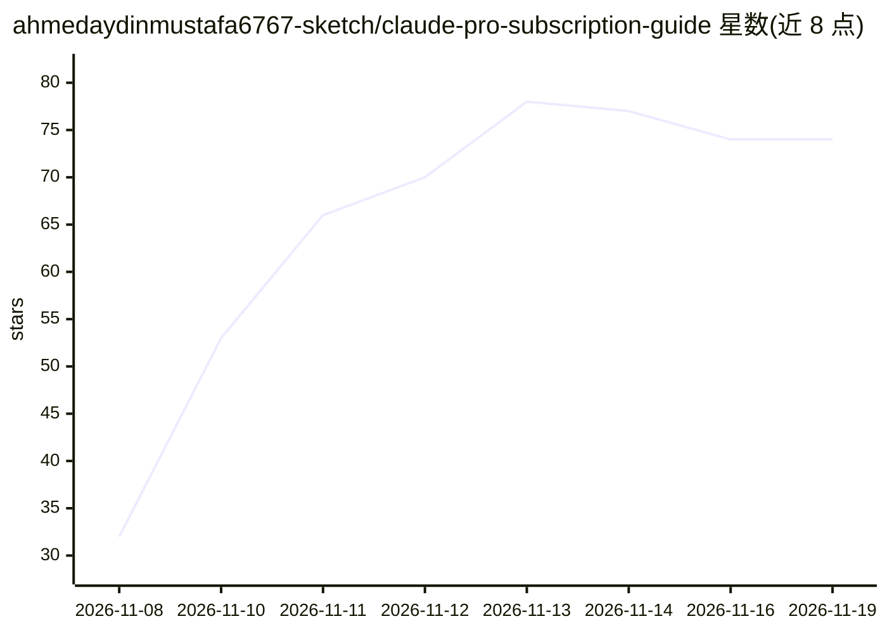

# ahmedaydinmustafa6767-sketch/claude-pro-subscription-guide

⭐ 74 · 推送 2026-11-02 · [GitHub](https://github.com/ahmedaydinmustafa6767-sketch/claude-pro-subscription-guide) · [官网](https://app.coregold.io/signup?invite_code=ADvlj9b) · 个人维护 · 中文 README

**教用户用 CoreGold 虚拟卡订阅 Claude Pro 的推广指南**

以教程形式呈现的 CoreGold 虚拟卡推广文档：解释 Anthropic 风控拒卡与砍单机制（发卡行属地校验、AVS 地址比对、预授权验资），随后分三步指导用户注册 CoreGold、以 USDT 充值、生成欧美商业 Visa/Mastercard 虚拟卡并绑定 Claude 结算页完成订阅。文内含对比表格与注册链接，本质为引导注册该发卡服务的营销内容，非软件项目，无可安装代码。

## 筛选速览

| 维度 | 判定 | 备注 |
|---|---|---|
| AI 角色 | `ai-knowledge` | 知识聚合/清单类 |
| 许可风险 | `none` | — |
| 部署形态 | `None` |  |
| 模型依赖 | — | README 未给出锁定关系 |
| 硬件要求 | — | 无带数字的原话,不猜 |
| 安装摩擦 | `low` | 无编译、无系统依赖或容器化 |
| 成熟度 | — | 结构信号不足 |

## 能力要点

- 解释 Anthropic/Stripe 拒卡与 Ghost Cancel 砍单机制
- 三步流程：USDT 充值→生成商业卡→绑卡订阅 Claude Pro/Team
- 虚拟卡配套提供英文账单地址与 5 位 ZIP 邮编

## 适用场景

- 了解海外订阅服务拒卡的风控原因
- 按步骤使用 CoreGold 虚拟卡完成 Claude 订阅付费

## 场景标签

 · 领域:支付/订阅教程（推广内容）

## 证据(README 行号)

> L2: ⚡ 2026 最新实测：手把手教你用 CoreGold 3 分钟开通 Claude Pro / Team
> L28: ### 第一步：注入底池（1 分钟）
> L50: 👉 **点击注册并进入 CoreGold 发卡后台**

## 星数曲线

2026-11-08 32 → 2026-11-19 74（+42）

---
*卡片 v1 · prompt 1.4 · 生成 2026-11-18 · 置信度 high · 依据 README sha `0c920a6b55b6` · [字段定义](../../DATASET.md)*
