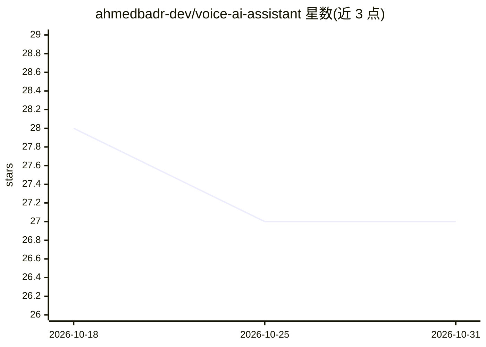

# ahmedbadr-dev/voice-ai-assistant

⭐ 27 · Python · MIT · 推送 2026-10-16 · [GitHub](https://github.com/ahmedbadr-dev/voice-ai-assistant) · 个人维护

**语音对话 AI 助手：麦克风识别→Gemini 回答→离线 TTS 播报**

一个 Python 语音助手小项目：通过麦克风采集音频，用 SpeechRecognition + PyAudio 转写为文本（默认语言 ar-EG），将文本发送给 Google Gemini 获取回答，再用 pyttsx3 离线 TTS 以系统语音播报回复。API key 通过 .env 配置，不在源码中硬编码；支持阿拉伯语/英语退出短语结束循环。定位为面向 Windows 的学习/作品集演示项目，需 Python 3.11+、可用麦克风与 Gemini API key；PyAudio 在 Windows 安装失败时可用 pipwin 安装。

## 筛选速览

| 维度 | 判定 | 备注 |
|---|---|---|
| AI 角色 | `ai-native` | 本体是模型或模型工具 |
| 许可风险 | `permissive` | MIT |
| 部署形态 | `library` | 以包/库形式分发 |
| 模型依赖 | — | README 未给出锁定关系 |
| 硬件要求 | — | 无带数字的原话,不猜 |
| 安装摩擦 | `low` | 无编译、无系统依赖或容器化 |
| 成熟度 | — | 结构信号不足 |

## 能力要点

- 麦克风 STT（Google Speech Recognition，默认 ar-EG）+ Gemini 生成回答 + pyttsx3 离线 TTS 的完整语音循环
- 通过 .env 配置 GOOGLE_API_KEY，源码不含密钥
- 可配置 GEMINI_MODEL、识别语言与 TTS 语速

## 适用场景

- 在 Windows 上体验语音到 AI 回答再到语音播报的完整链路
- 作为语音识别 + LLM + TTS 集成的学习示例
- 用阿拉伯语或英语语音与 Gemini 对话

## 场景标签

`语音 Agent` · 领域:对话与助手

## 证据(README 行号)

> L13: - **Speech-to-text** via Google Speech Recognition (default locale: Egyptian Arabic `ar-EG`)
> L14: - **LLM answers** powered by Google Gemini
> L15: - **Text-to-speech** replies with `pyttsx3` (system voices)

## 星数曲线

2026-10-18 28 → 2026-10-31 27（-1）

---
*卡片 v1 · prompt 1.4 · 生成 2026-10-26 · 置信度 high · 依据 README sha `2994259ef6fd` · [字段定义](../../DATASET.md)*
