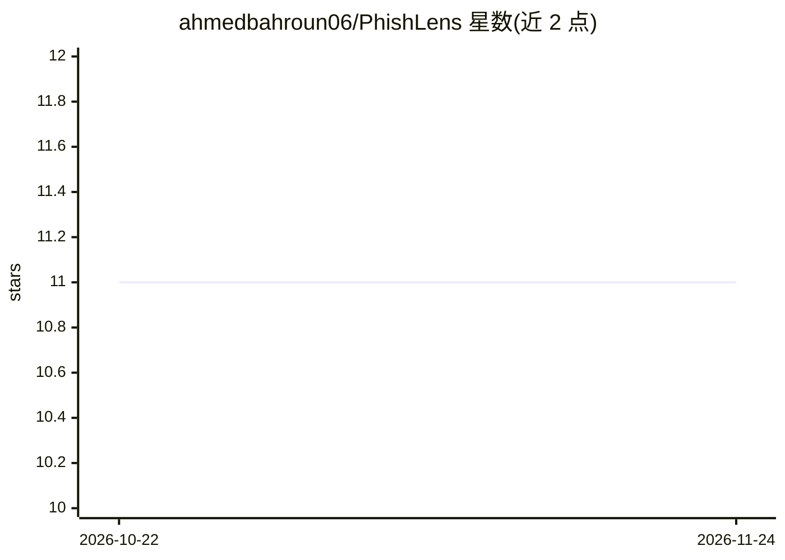

# ahmedbahroun06/PhishLens

⭐ 11 · Python · 推送 2026-10-03 · [GitHub](https://github.com/ahmedbahroun06/PhishLens) · [官网](https://phishlens-va98.onrender.com) · 个人维护

**面向邮件分析者的可解释钓鱼邮件取证检测工具**

分析单封可疑邮件并输出 Phishing/Suspicious/Clean 三级判定与 0–100 评分，每项信号以明文解释并给出分值贡献。流程为先做技术取证（SPF/DKIM/DMARC 认证、链接与仿冒域名、QR 码解码、VirusTotal URL 信誉），再由 LLM（Groq）对结构化证据做推理说明，透明加权计分。提供 Web 界面（FastAPI）、CLI 与 JSON API；无 API key 时降级为本地启发式。明确不是邮箱监控或垃圾过滤工具。

## 筛选速览

| 维度 | 判定 | 备注 |
|---|---|---|
| AI 角色 | `ai-native` | 本体是模型或模型工具 |
| 许可风险 | `permissive` | — |
| 部署形态 | `self-host` | docker 或自建部署 |
| 模型依赖 | locked-api |  |
| 硬件要求 | — | 无带数字的原话,不猜 |
| 安装摩擦 | `low` | 无编译、无系统依赖或容器化 |
| 成熟度 | — | 结构信号不足 |

## 能力要点

- SPF/DKIM/DMARC 认证校验与 Reply-To 错配、同形字仿冒域名检测
- 邮件内 QR 码解码并核查隐藏 URL，VirusTotal v3 信誉查询结果缓存于 SQLite
- 透明评分机制：各信号加权累加，AI 文本启发式仅占 +5 且不可单独决定判定
- 无 API key 时优雅降级，技术信号照常运行并标注缺失服务

## 适用场景

- 上传 .eml 文件核实一封可疑邮件是否为钓鱼
- 获取带证据清单和分数的审计报告供后续处置决策
- 通过 CLI 批量分析邮件样本并用退出码区分判定结果

## 场景标签

`网络安全` · 领域:学习与行业

## 证据(README 行号)

> L10: PhishLens analyzes one suspicious email and tells you whether it's **Phishing**, **Suspicious**, or **Clean**, with
> L18: Most "AI phishing detectors" send the raw email to an LLM and ask for an opinion. PhishLens does the opposite order
> L21: 2. Then an LLM (Groq) reasons over that **structured, verifiable evidence** and explains it.

## 星数曲线

2026-10-22 11 → 2026-11-24 11（+0）

---
*卡片 v1 · prompt 1.4 · 生成 2026-11-18 · 置信度 high · 依据 README sha `8d44126b2ffd` · [字段定义](../../DATASET.md)*
