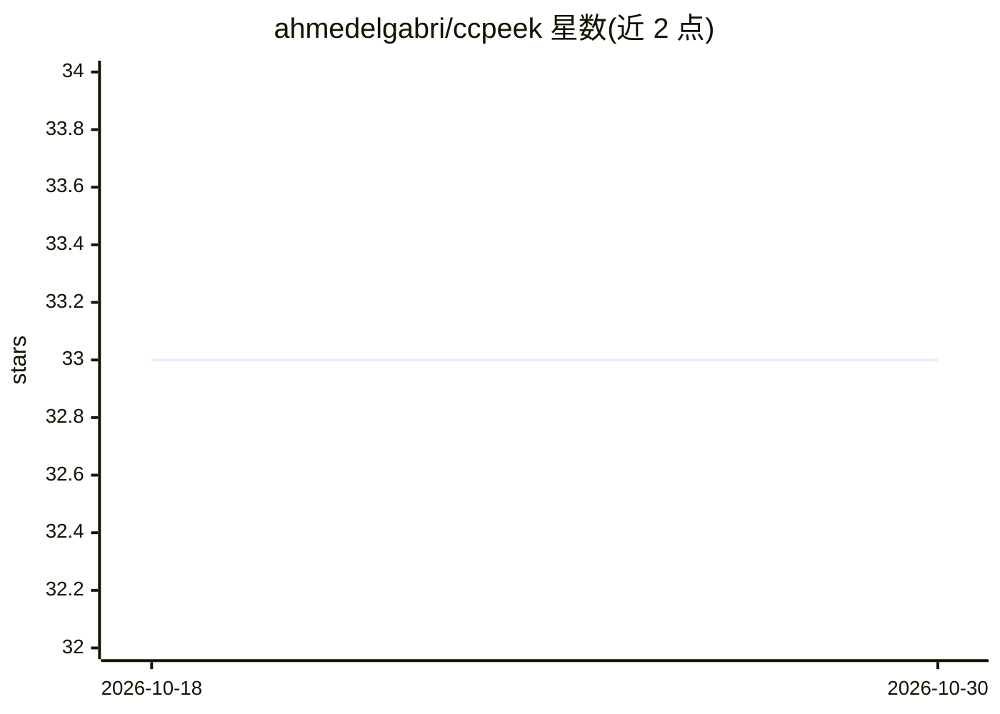

# ahmedelgabri/ccpeek

⭐ 33 · Go · MIT · 推送 2026-10-22 · [GitHub](https://github.com/ahmedelgabri/ccpeek) · 个人维护

**本地索引与浏览多个编程 agent 会话历史的 Web 应用**

用 Go 编写的本地 Web 应用，将 Claude Code、Pi、Codex CLI、OpenCode（Cursor 为实验性支持）的会话数据索引到单一数据库，覆盖对话、计划、todos、shell 快照、文件历史、token 用量与成本估算，并提供三种查询面：ccpeek query（CLI JSON）、/api/v1（HTTP）与 ccpeek mcp（MCP over stdio），三者由同一共享定义生成。附带 gitleaks 规则的密钥泄漏扫描、备份/恢复与增量索引。所有数据留在本机。

## 筛选速览

| 维度 | 判定 | 备注 |
|---|---|---|
| AI 角色 | `ai-ecosystem` | LLM/agent 周边工具 |
| 许可风险 | `permissive` | MIT |
| 部署形态 | `library` | 以包/库形式分发 |
| 模型依赖 | — | README 未给出锁定关系 |
| 硬件要求 | — | 无带数字的原话,不猜 |
| 安装摩擦 | `low` | 无编译、无系统依赖或容器化 |
| 成熟度 | — | 结构信号不足 |

## 能力要点

- 索引 5 种编程 agent 的会话、工件与 token/成本数据
- CLI / HTTP / MCP 三种共享定义的 agent 查询面
- 基于 gitleaks 规则（150+ 模式）的密钥泄漏扫描
- 增量索引与多 GB 历史的快速热启动

## 适用场景

- 跨多个编程 agent 统一查阅历史会话与成本
- 让 agent 通过 MCP/API 检索过往会话数据
- 扫描 agent 会话中泄漏的密钥与 token

## 场景标签

`网络安全` · 领域:学习与行业

## 证据(README 行号)

> L3: Explore your coding-agent history. A local web app that indexes
> L173: Every read is available three ways — `ccpeek query` (JSON on the
> L174: command line), `/api/v1` (HTTP), and `ccpeek mcp` (MCP over stdio) —

## 星数曲线

2026-10-18 33 → 2026-10-30 33（+0）

---
*卡片 v1 · prompt 1.4 · 生成 2026-10-25 · 置信度 mid · 依据 README sha `bcba3fc5f4d5` · [字段定义](../../DATASET.md)*
