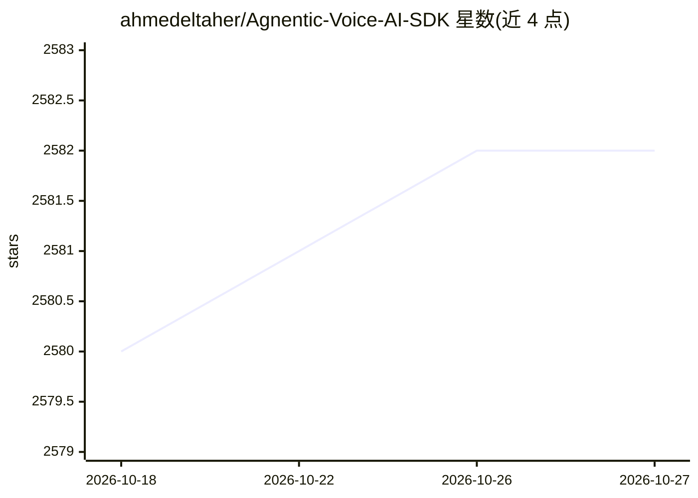

# ahmedeltaher/Agnentic-Voice-AI-SDK

⭐ 2,582 · Kotlin · 推送 2026-06-01 · [GitHub](https://github.com/ahmedeltaher/Agnentic-Voice-AI-SDK) · [官网](https://ahmedeltaher.github.io/Android-MVVM-Architecture-Voice-AI/) · 个人维护

**Android 语音 AI 对话 SDK：为应用提供 STT-Claude-TTS 全链路**

面向 Android 开发者的可复用语音 AI 对话库：采集麦克风音频，经 VAD 与 STT 转写，发送给 Anthropic Claude 生成回复，再通过 TTS 播报，全部由单个 VoiceAISDK.Builder 调用串联。提供即用 Jetpack Compose 组件（VoiceButton、ConversationView 等）、可替换的 STT/TTS 引擎适配器（Whisper、ElevenLabs、Hume AI）、端上情绪检测，以及 PII 脱敏、加密密钥存储与证书固定等安全工具。要求 Android Studio Meerkat+、minSdk 24、Kotlin 2.0+ 与 Anthropic API key；AI 引擎仅有 Claude 一项。

## 筛选速览

| 维度 | 判定 | 备注 |
|---|---|---|
| AI 角色 | `ai-ecosystem` | LLM/agent 周边工具 |
| 许可风险 | `permissive` | — |
| 部署形态 | `None` |  |
| 模型依赖 | locked-api |  |
| 硬件要求 | — | 无带数字的原话,不猜 |
| 安装摩擦 | `low` | 无编译、无系统依赖或容器化 |
| 成熟度 | — | 结构信号不足 |

## 能力要点

- 麦克风→VAD→STT→Claude→TTS 单一 Builder 串成完整管线
- 可替换引擎适配器：Whisper STT、ElevenLabs TTS、Hume AI 情绪检测
- 端上语音情绪检测（7 类）并可注入 Claude 上下文
- 安全机制：PII 脱敏、EncryptedSharedPreferences 密钥存储、OkHttp 证书固定

## 适用场景

- 给自己的 Android 应用加一条语音 AI 对话链路
- 免搭管线直接嵌入现成的语音对话 Compose UI
- 需要密钥加密与 PII 脱敏的合规语音助手场景

## 场景标签

`语音 Agent` · 领域:对话与助手

## 证据(README 行号)

> L26: The Android Voice AI SDK is a reusable Android library that gives any app a full voice-driven AI conversation pipel
> L138: |**AI**|`ai/`|`AIEngine` interface backed by `ClaudeAIEngine`, which wraps the official Anthropic Java SDK and mai

## 星数曲线

2026-10-18 2,580 → 2026-10-27 2,582（+2）

---
*卡片 v1 · prompt 1.4 · 生成 2026-10-21 · 置信度 high · 依据 README sha `e325acfc52e6` · [字段定义](../../DATASET.md)*
