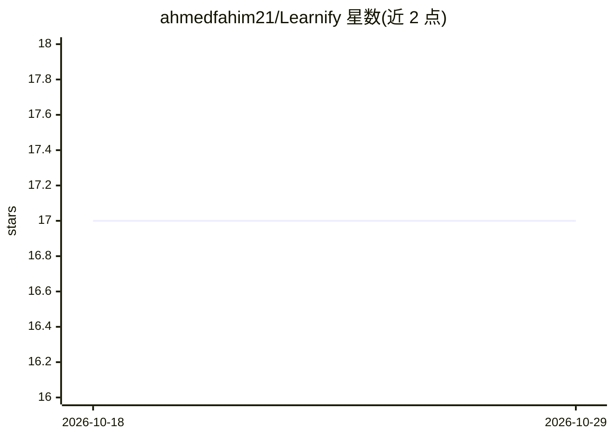

# ahmedfahim21/Learnify

⭐ 17 · TypeScript · 推送 2026-08-22 · [GitHub](https://github.com/ahmedfahim21/Learnify) · 个人维护

**生成式 UI 的 AI 导师应用：任意主题实时自适应授课**

面向学习者的 Web 应用：由 Claude（经 AWS Bedrock 接入）在会话中逐屏生成教学内容——讲解、测验、闪卡、图示与练习以 A2UI 声明式 UI 流式渲染，并根据回答实时调整。内置先修概念图的掌握度引擎（EMA + SM-2 间隔重复）与跨会话的学习偏好记忆；可附加 PDF、URL、YouTube 视频作为带引用的教学来源。渲染器仅解释数据、不执行模型生成的代码。技术栈为 Next.js 15 + TypeScript，运行时必需 Neon Postgres 数据库与 AWS Bedrock 凭据。

## 筛选速览

| 维度 | 判定 | 备注 |
|---|---|---|
| AI 角色 | `ai-native` | 本体是模型或模型工具 |
| 许可风险 | `none` | — |
| 部署形态 | `library` | 以包/库形式分发 |
| 模型依赖 | locked-api |  |
| 硬件要求 | — | 无带数字的原话,不猜 |
| 安装摩擦 | `low` | 无编译、无系统依赖或容器化 |
| 成熟度 | — | 结构信号不足 |

## 能力要点

- Claude 通过严格工具调用逐屏流式生成 A2UI 声明式 UI 教学界面
- 先修概念图掌握度追踪（EMA + SM-2 间隔重复）与每日 Today 面板
- 跨会话学习偏好记忆（风格、兴趣、过往误解）
- 基于 PDF/URL/YouTube 来源授课，引用可跳转至原文/页码/时间戳

## 适用场景

- 按自己的节奏学习任意主题并实时获得适应性练习
- 追踪概念掌握度并通过间隔重复巩固薄弱点
- 基于自己的文档或视频资料构建有出处的学习内容

## 场景标签

`AI 助手` `文档问答` · 领域:对话与助手

## 证据(README 行号)

> L6: serving pre-written courses, the tutor — Claude on AWS Bedrock — generates each
> L31: A session is an agent loop: Claude emits UI through strict tool calls as A2UI

## 星数曲线

2026-10-18 17 → 2026-10-29 17（+0）

---
*卡片 v1 · prompt 1.4 · 生成 2026-10-29 · 置信度 high · 依据 README sha `449ccec1e728` · [字段定义](../../DATASET.md)*
