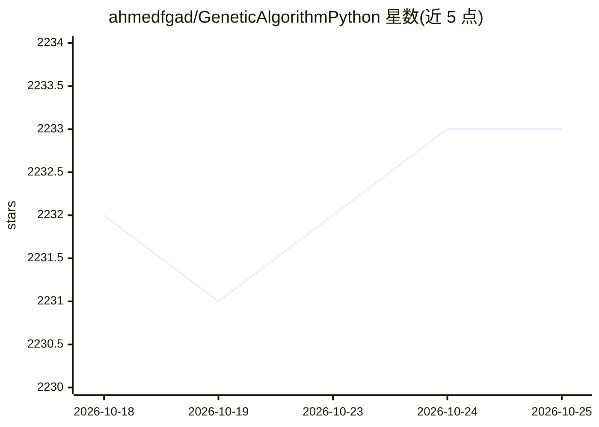

# ahmedfgad/GeneticAlgorithmPython

⭐ 2,233 · Python · BSD-3-Clause · 推送 2026-10-23 · [GitHub](https://github.com/ahmedfgad/GeneticAlgorithmPython) · [官网](https://pygad.readthedocs.io) · 个人维护

**Python 遗传算法库：用 GA 优化问题并训练 Keras/PyTorch 模型**

PyGAD 是 Python 3 的遗传算法构建与优化库：支持多种交叉、变异与父代选择算子，用户通过自定义适应度函数即可对单目标与多目标问题做优化，并可训练 Keras 与 PyTorch 模型。核心安装仅依赖 numpy 与 cloudpickle，绘图等功能通过可选 extras 安装。提供回调函数追踪 GA 生命周期，文档托管于 Read the Docs，当前版本 3.8.1，要求 Python 3.8+，附云运行工具 Vilvik 的接入说明与教程、书籍链接。

## 筛选速览

| 维度 | 判定 | 备注 |
|---|---|---|
| AI 角色 | `ai-native` | 本体是模型或模型工具 |
| 许可风险 | `permissive` | BSD-3-Clause |
| 部署形态 | `library` | 以包/库形式分发 |
| 模型依赖 | — | README 未给出锁定关系 |
| 硬件要求 | — | 无带数字的原话,不猜 |
| 安装摩擦 | `low` | 无编译、无系统依赖或容器化 |
| 成熟度 | — | 结构信号不足 |

## 能力要点

- 支持 Keras 与 PyTorch 模型的遗传算法训练
- 单目标与多目标问题优化，自定义适应度函数
- 多种交叉、变异与父代选择类型
- 核心安装仅依赖 numpy 与 cloudpickle，其余功能按 extras 可选安装

## 适用场景

- 用遗传算法优化自定义适应度函数描述的问题
- 以 GA 替代梯度方法训练 Keras/PyTorch 神经网络
- 通过回调函数追踪与控制遗传算法各代执行

## 场景标签

 · 领域:优化/进化计算

## 证据(README 行号)

> L3: PyGAD is an open-source, easy-to-use Python 3 library for building the genetic algorithm and optimizing machine lear
> L21: PyGAD supports different types of crossover, mutation, and parent selection. It lets you optimize many types of pro

## 星数曲线

2026-10-18 2,232 → 2026-10-25 2,233（+1）

---
*卡片 v1 · prompt 1.4 · 生成 2026-10-21 · 置信度 high · 依据 README sha `3f58ed2b1e4e` · [字段定义](../../DATASET.md)*
