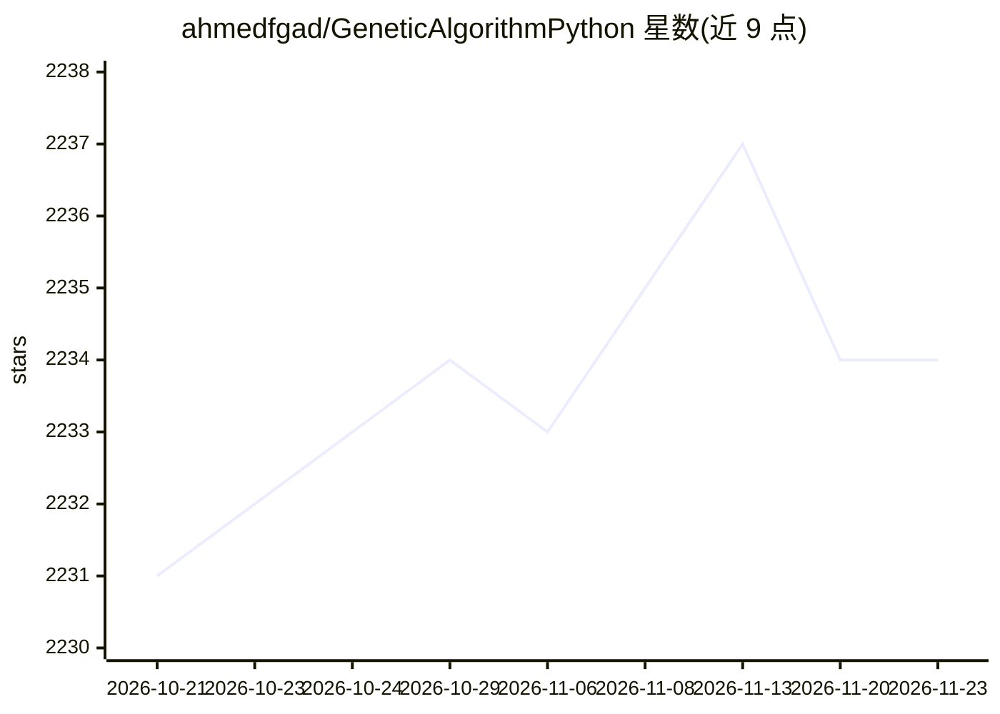

# ahmedfgad/GeneticAlgorithmPython

⭐ 2,234 · Python · BSD-3-Clause · 推送 2026-10-23 · [GitHub](https://github.com/ahmedfgad/GeneticAlgorithmPython) · [官网](https://pygad.readthedocs.io) · 个人维护

**遗传算法 Python 库：优化问题与机器学习训练**

PyGAD 是一个 Python 3 库，用于构建遗传算法并优化机器学习算法，支持 Keras 与 PyTorch，可处理单目标与多目标问题。提供多种交叉、变异与父代选择方式，用户通过自定义适应度函数优化各类问题。核心安装仅依赖 numpy 与 cloudpickle，绘图等功能以可选 extras 提供。当前版本 3.9.2，要求 Python 3.8+，文档托管于 Read the Docs，另提供云端运行工具 Vilvik。

## 筛选速览

| 维度 | 判定 | 备注 |
|---|---|---|
| AI 角色 | `ai-native` | 本体是模型或模型工具 |
| 许可风险 | `permissive` | BSD-3-Clause |
| 部署形态 | `library` | 以包/库形式分发 |
| 模型依赖 | — | README 未给出锁定关系 |
| 硬件要求 | — | 无带数字的原话,不猜 |
| 安装摩擦 | `low` | 无编译、无系统依赖或容器化 |
| 成熟度 | — | 结构信号不足 |

## 能力要点

- 支持 Keras 与 PyTorch 模型优化，及单/多目标问题
- 支持多种交叉、变异与父代选择方式，自定义适应度函数
- 核心安装轻量，仅依赖 numpy 与 cloudpickle，可选 extras 扩展
- 提供 pygad.GA 实例生命周期回调函数与完整文档/示例

## 适用场景

- 用遗传算法求解单目标/多目标优化问题
- 用遗传算法训练 Keras 或 PyTorch 神经网络
- 编写自定义适应度函数优化各类问题

## 场景标签

`模型训练` · 领域:训练与推理

## 证据(README 行号)

> L3: PyGAD is an open-source, easy-to-use Python 3 library for building the genetic algorithm and optimizing machine lear
> L21: PyGAD supports different types of crossover, mutation, and parent selection. It lets you optimize many types of pro

## 星数曲线

2026-10-21 2,231 → 2026-11-23 2,234（+3）

---
*卡片 v1 · prompt 1.4 · 生成 2026-11-23 · 置信度 high · 依据 README sha `1ff8539f393f` · [字段定义](../../DATASET.md)*
