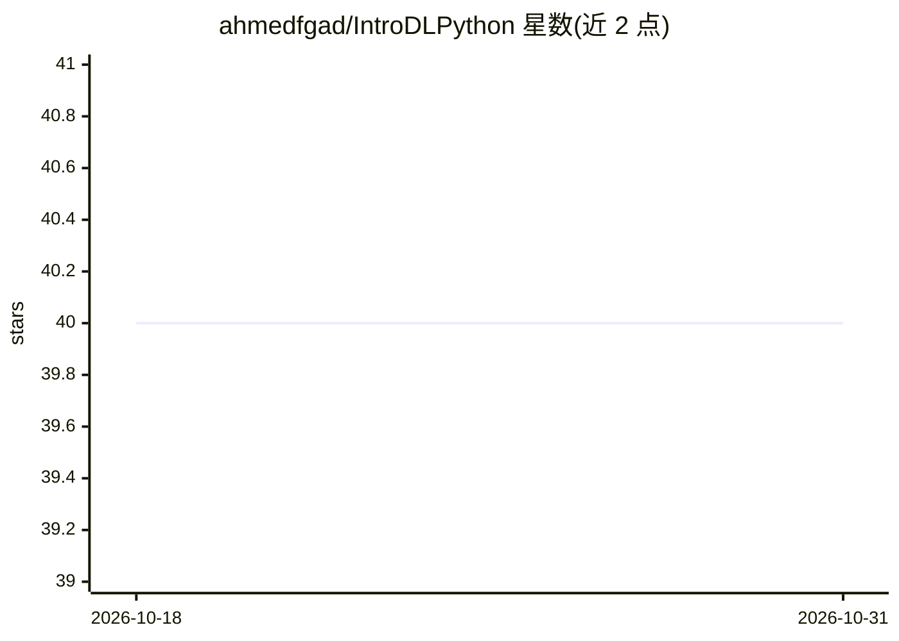

# ahmedfgad/IntroDLPython

⭐ 40 · Python · 推送 2026-10-17 · [GitHub](https://github.com/ahmedfgad/IntroDLPython) · [官网](https://www.linkedin.com/in/ahmedfgad) · 个人维护

**深度学习入门书的配套代码示例仓库（面向神经科学家）**

书籍《Introduction to Deep Learning and Neural Networks with Python: A Practical Guide》（Ahmed Fawzy Gad & Fatima Ezzahra Jarmouni，2020）的 GitHub 配套项目，收录多个深度学习入门示例，使用 NumPy 与 Python 从零实现神经网络。内容覆盖从最简模型 Y=X 到通用梯度下降算法的手动前向/反向传播计算，以数学推导配合 Python 代码示例讲解。面向神经科学家与深度学习初学者。README 未给出安装命令与运行说明。

## 筛选速览

| 维度 | 判定 | 备注 |
|---|---|---|
| AI 角色 | `ai-knowledge` | 知识聚合/清单类 |
| 许可风险 | `none` | — |
| 部署形态 | `None` |  |
| 模型依赖 | — | README 未给出锁定关系 |
| 硬件要求 | — | 无带数字的原话,不猜 |
| 安装摩擦 | `low` | 无编译、无系统依赖或容器化 |
| 成熟度 | — | 结构信号不足 |

## 能力要点

- 配套 2020 年出版书籍的官方代码仓库
- 以 NumPy/Python 从零实现神经网络计算
- 覆盖梯度下降算法的前向与反向手动推导与实现

## 适用场景

- 跟随书籍章节动手练习神经网络计算
- 学习用纯 NumPy 实现梯度下降与前向/反向传播
- 作为神经科学背景读者的深度学习入门材料

## 场景标签

`教程课程` · 领域:学习与行业

## 证据(README 行号)

> L1: # Introduction to Deep Learning with Python
> L3: This repository is the GitHub project of this book: Ahmed Fawzy Gad & Fatima Ezzahra Jarmouni, Introduction to Deep 
> L9: *Introduction to Deep Learning and Neural Networks with Python™: A Practical Guide* is an intensive step-by-step gui

## 星数曲线

2026-10-18 40 → 2026-10-31 40（+0）

---
*卡片 v1 · prompt 1.4 · 生成 2026-10-25 · 置信度 high · 依据 README sha `db27f6f96eb6` · [字段定义](../../DATASET.md)*
