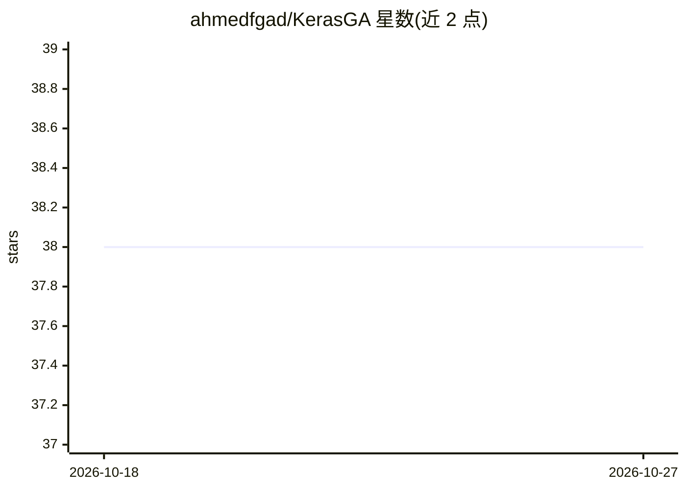

# ahmedfgad/KerasGA

⭐ 38 · Jupyter Notebook · 推送 2026-10-17 · [GitHub](https://github.com/ahmedfgad/KerasGA) · [官网](https://pygad.readthedocs.io) · 个人维护

**PyGAD 子模块：用遗传算法训练 Keras 模型**

PyGAD 库的 Keras 适配模块，仅含单一模块 kerasga.py 与 KerasGA 类，用于把 Keras 模型参数准备为遗传算法可优化的初始种群，配合 PyGAD 的 GA 生命周期（回调、代数控制）完成训练。面向使用 TensorFlow/Keras 并希望以遗传算法替代梯度方法训练模型的开发者；README 提供回归与 XOR 二分类两个完整示例，并链接大量遗传算法与神经网络教程及作者著作。

## 筛选速览

| 维度 | 判定 | 备注 |
|---|---|---|
| AI 角色 | `ai-ecosystem` | LLM/agent 周边工具 |
| 许可风险 | `none` | — |
| 部署形态 | `library` | 以包/库形式分发 |
| 模型依赖 | — | README 未给出锁定关系 |
| 硬件要求 | — | 无带数字的原话,不猜 |
| 安装摩擦 | `low` | 无编译、无系统依赖或容器化 |
| 成熟度 | — | 结构信号不足 |

## 能力要点

- KerasGA 类生成 Keras 模型参数的初始种群供 GA 优化
- 随 PyGAD 经 pip 安装，支持 GA 回调与代数控制
- 提供回归训练与 XOR 二分类两个代码示例

## 适用场景

- 用遗传算法替代梯度下降训练 Keras 模型
- 需要种群式优化的神经网络训练实验
- 学习遗传算法与神经网络结合的教程资源

## 场景标签

 · 领域:机器学习/优化算法

## 证据(README 行号)

> L1: # KerasGA: Training Keras Models using the Genetic Algorithm
> L2: KerasGA is part of the PyGAD library for training Keras models using the genetic algorithm (GA).
> L4: The KerasGA project has a single module named `kerasga.py` which has a class named `KerasGA` for preparing an initia

## 星数曲线

2026-10-18 38 → 2026-10-27 38（+0）

---
*卡片 v1 · prompt 1.4 · 生成 2026-10-25 · 置信度 high · 依据 README sha `adfe1f7649b2` · [字段定义](../../DATASET.md)*
