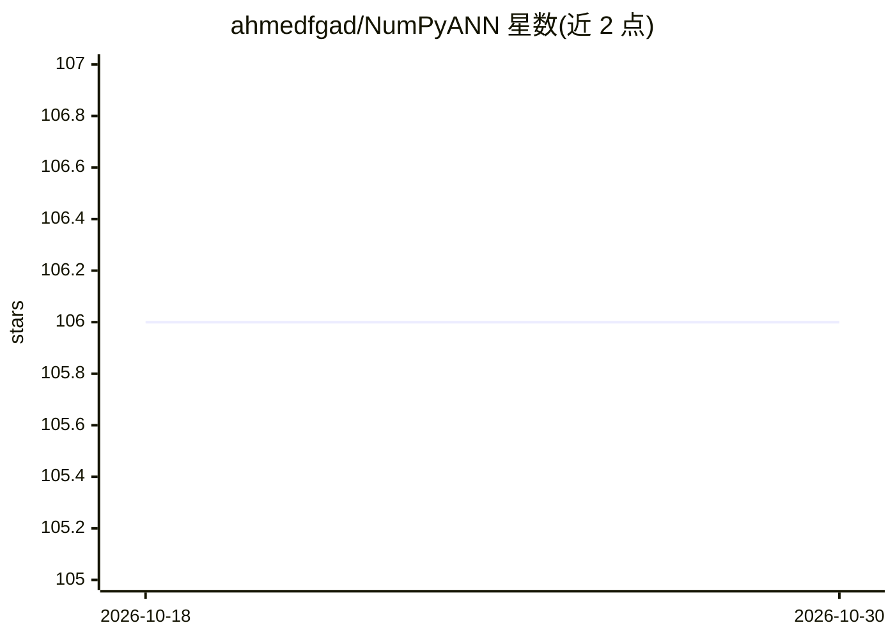

# ahmedfgad/NumPyANN

⭐ 106 · Python · 推送 2026-10-17 · [GitHub](https://github.com/ahmedfgad/NumPyANN) · [官网](https://pygad.readthedocs.io) · 个人维护

**用 NumPy 从零实现神经网络的 Python 库（PyGAD 的 pygad.nn 模块源码）**

本项目是 PyGAD 生态中 pygad.nn 模块的源码仓库，仅用 NumPy 实现前馈人工神经网络，支持回归与分类任务，从 PyGAD 2.7.0 起集成。神经网络可配合遗传算法（pygad.gann）训练权重。安装通过 pip 安装 pygad 包获得，文档托管于 Read the Docs；README 同时作为多篇教程（LinkedIn/TDS/KDnuggets）与作者著作的入口，教程示例代码移至 TutorialProject 目录。

## 筛选速览

| 维度 | 判定 | 备注 |
|---|---|---|
| AI 角色 | `ai-native` | 本体是模型或模型工具 |
| 许可风险 | `none` | — |
| 部署形态 | `library` | 以包/库形式分发 |
| 模型依赖 | — | README 未给出锁定关系 |
| 硬件要求 | — | 无带数字的原话,不猜 |
| 安装摩擦 | `low` | 无编译、无系统依赖或容器化 |
| 成熟度 | — | 结构信号不足 |

## 能力要点

- 仅依赖 NumPy 实现全连接神经网络（含隐藏层）
- 支持回归与分类任务，自 PyGAD 2.7.0 起集成
- 可与遗传算法模块 pygad.gann 结合训练网络
- 配套 Fruits360 数据集教程项目与多篇教程文章

## 适用场景

- 学习神经网络的前向传播与实现的底层原理
- 在不使用深度学习框架的前提下构建小型回归/分类网络
- 用遗传算法替代反向传播优化网络权重

## 场景标签

 · 领域:机器学习/教育

## 证据(README 行号)

> L3: NumPyANN is a Python project for building artificial neural networks using NumPy.
> L5: NumPyANN is part of PyGAD which is an open-source Python 3 library for implementing the genetic algorithm and optimi

## 星数曲线

2026-10-18 106 → 2026-10-30 106（+0）

---
*卡片 v1 · prompt 1.4 · 生成 2026-10-23 · 置信度 high · 依据 README sha `d923b7e94bb1` · [字段定义](../../DATASET.md)*
