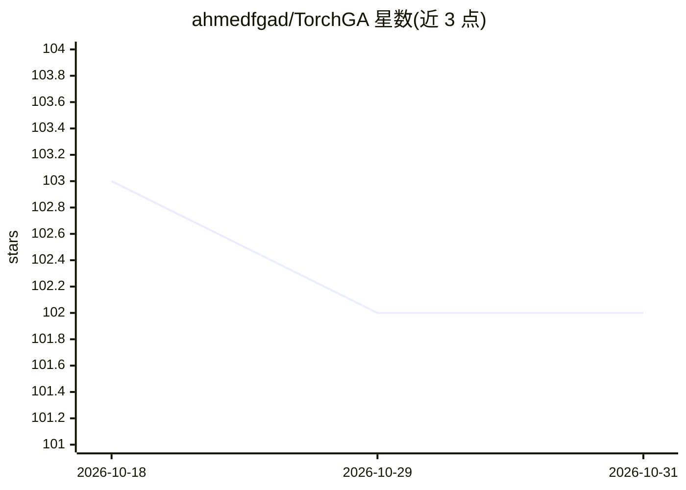

# ahmedfgad/TorchGA

⭐ 102 · Python · 推送 2026-10-17 · [GitHub](https://github.com/ahmedfgad/TorchGA) · [官网](https://pygad.readthedocs.io) · 个人维护

**用遗传算法训练 PyTorch 模型的 PyGAD 子模块**

PyGAD 库（2.10.0 起）的 torchga 子模块，核心为单个 torchga.py 模块与 TorchGA 类，用于准备 PyTorch 模型参数的初始种群，配合 pygad.GA 的遗传算法生命周期（on_start/on_fitness 等回调、按代数或 stop 返回终止）训练模型。README 提供回归与 XOR 二分类两个示例，安装方式为 pip 安装 pygad，另链接 NumPyANN、NumPyCNN、KerasGA 等姊妹项目及多篇教程与书籍。

## 筛选速览

| 维度 | 判定 | 备注 |
|---|---|---|
| AI 角色 | `ai-ecosystem` | LLM/agent 周边工具 |
| 许可风险 | `none` | — |
| 部署形态 | `library` | 以包/库形式分发 |
| 模型依赖 | — | README 未给出锁定关系 |
| 硬件要求 | — | 无带数字的原话,不猜 |
| 安装摩擦 | `low` | 无编译、无系统依赖或容器化 |
| 成熟度 | — | 结构信号不足 |

## 能力要点

- TorchGA 类生成 PyTorch 模型参数初始种群
- 依托 pygad.GA 生命周期回调机制执行遗传算法训练
- 提供回归与 XOR 二分类两个完整示例
- 属于 PyGAD 生态，与 kerasga/gann/gacnn 等模块并列

## 适用场景

- 用遗传算法代替梯度下降训练 PyTorch 模型
- 在 PyGAD 流程中优化神经网络权重
- 学习遗传算法与神经网络结合的实现方式

## 场景标签

`模型训练` · 领域:训练与推理

## 证据(README 行号)

> L2: TorchGA is part of the PyGAD library for training PyTorch models using the genetic algorithm (GA). This feature is s
> L4: The TorchGA project has a single module named `torchga.py` which has a class named `TorchGA` for preparing an initia

## 星数曲线

2026-10-18 103 → 2026-10-31 102（-1）

---
*卡片 v1 · prompt 1.4 · 生成 2026-10-23 · 置信度 high · 依据 README sha `3fb04797c006` · [字段定义](../../DATASET.md)*
