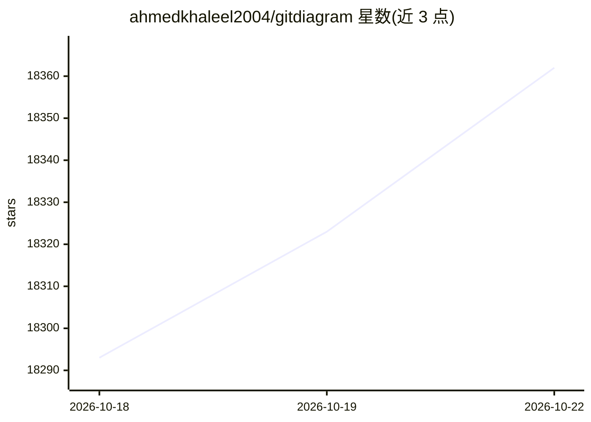

# ahmedkhaleel2004/gitdiagram

⭐ 18,362 · TypeScript · MIT · 推送 2026-10-20 · [GitHub](https://github.com/ahmedkhaleel2004/gitdiagram) · [官网](https://gitdiagram.com) · 个人维护

**把 GitHub 仓库转成交互式架构图与一分钟讲解视频**

将公开或私有 GitHub 仓库转换为可交互的架构图：点击组件可跳转到对应文件或目录，支持导出 PNG 或复制 Mermaid 源码；私有仓库通过 GitHub token 访问。近期新增生成约一分钟解说视频的功能（制作新视频处于 early access）。对外提供远程 MCP 服务器（无需 key），供 Claude、Cursor、VS Code、ChatGPT 等 agent 客户端读取仓库架构说明与 Mermaid 源码。本地运行需 Bun、Cloudflare R2、Upstash Redis 及 OpenAI 或 OpenRouter API key。

## 筛选速览

| 维度 | 判定 | 备注 |
|---|---|---|
| AI 角色 | `ai-enhanced` | 去掉 AI 部分产品仍成立 |
| 许可风险 | `permissive` | MIT |
| 部署形态 | `None` |  |
| 模型依赖 | locked-api |  |
| 硬件要求 | — | 无带数字的原话,不猜 |
| 安装摩擦 | `low` | 无编译、无系统依赖或容器化 |
| 成熟度 | `idea` | |

## 动量与使用信号

- 维护:`active` — 距上次 push 4.3 天,年发版 0,5 位贡献者
- 涨星:近 1 天 **+47**(自 20261016 起算)
- 安装:github 包 `release-assets` 月下载无数据
- 平台:— · 协议:MCP

## 能力要点

- AI 生成交互式架构图，点击组件跳转源码，可导出 PNG/Mermaid
- 远程 MCP 服务器（gitdiagram.com/mcp，无需 key）供 AI agent 调用
- 生成约一分钟解说视频，支持 MP4 横竖屏下载与内嵌字幕
- 支持通过 GitHub token 访问私有仓库

## 适用场景

- 快速了解陌生开源仓库的架构与组件连接
- 让 AI agent/Claude 读取项目结构后再做代码分析
- 为代码评审或文档生成架构图与讲解视频

## 场景标签

 · 领域:开发者工具/代码可视化

## 证据(README 行号)

> L3: Visualize any codebase: turn any public or private GitHub repository into an interactive architecture diagram, or wa
> L36: GitDiagram is a remote MCP server at `https://gitdiagram.com/mcp` (no key or sign-in). Agents can read a public rep
> L54: Requires Bun, Cloudflare R2, Upstash Redis, and an OpenAI or OpenRouter API key. See the setup guide for prerequisi

## 星数曲线

2026-10-18 18,293 → 2026-10-22 18,362（+69）

---
*卡片 v1 · prompt 1.4 · 生成 2026-10-18 · 置信度 high · 依据 README sha `ed38dbfe3906` · [字段定义](../../DATASET.md)*
