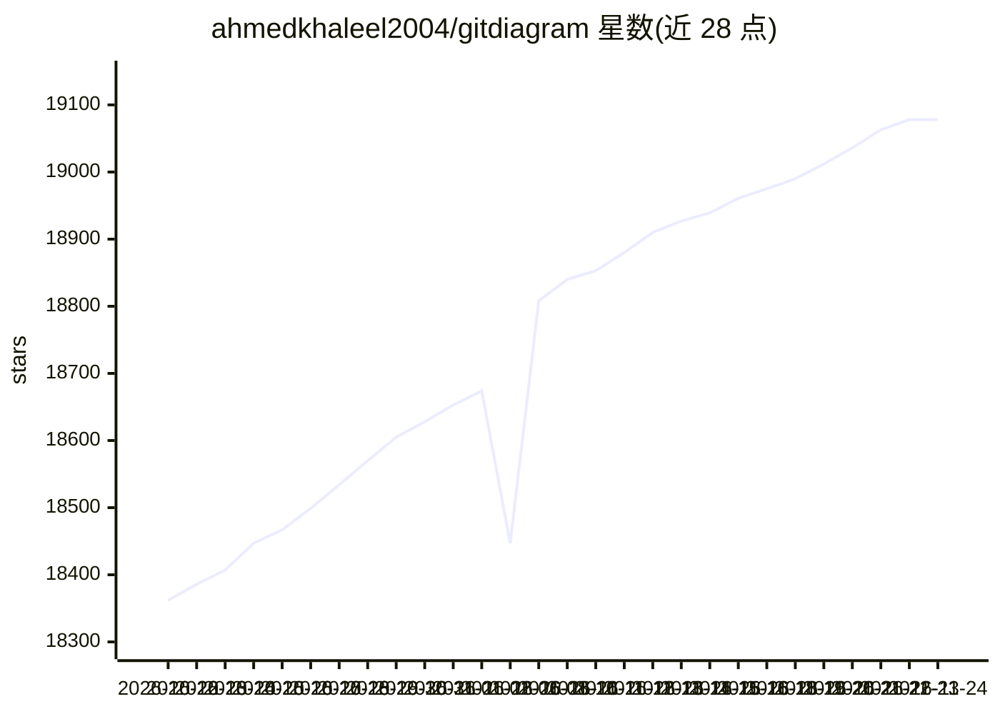

# ahmedkhaleel2004/gitdiagram

⭐ 19,095 · TypeScript · MIT · 推送 2026-11-23 · [GitHub](https://github.com/ahmedkhaleel2004/gitdiagram) · [官网](https://gitdiagram.com) · 个人维护

**将 GitHub 仓库转为交互式架构图与一分钟讲解视频**

面向开发者的代码库可视化服务：输入任意 GitHub 仓库 URL（将 hub 换成 diagram），生成 AI 驱动的交互式架构图，支持点击组件跳转到对应文件/目录、导出 PNG 或复制 Mermaid 源码；新增功能可将仓库生成约一分钟带解说的 MP4 讲解视频。支持私有仓库（GitHub token）。对外提供远程 MCP 服务器供 AI agent 读取架构信息，本地运行需 Bun、Cloudflare R2、Upstash Redis 及 LLM API key。视频生成功能目前处于 early access。

## 筛选速览

| 维度 | 判定 | 备注 |
|---|---|---|
| AI 角色 | `ai-native` | 本体是模型或模型工具 |
| 许可风险 | `permissive` | MIT |
| 部署形态 | `None` |  |
| 模型依赖 | — | README 未给出锁定关系 |
| 硬件要求 | — | 无带数字的原话,不猜 |
| 安装摩擦 | `low` | 无编译、无系统依赖或容器化 |
| 成熟度 | `idea` | |

## 动量与使用信号

- 维护:`active` — 距上次 push 4.3 天,年发版 0,5 位贡献者
- 涨星:近 1 天 **+47**(自 20261016 起算)
- 安装:github 包 `release-assets` 月下载无数据
- 平台:— · 协议:MCP

## 能力要点

- 将公开/私有仓库转为可点击跳转代码的交互式架构图
- 生成约一分钟带解说的 MP4 讲解视频（横屏/竖屏 9:16，内嵌字幕）
- 提供远程 MCP 服务器（gitdiagram.com/mcp，无需密钥）供 AI agent 调用
- 导出 PNG 或复制 Mermaid 源码

## 适用场景

- 快速了解陌生开源项目的整体结构与模块关系
- 让 Claude Code、Cursor 等 agent 读取仓库架构说明
- 为项目生成一分钟讲解视频用于分享

## 场景标签

`视频生成` · 领域:内容生成

## 证据(README 行号)

> L3: Visualize any codebase: turn any public or private GitHub repository into an interactive architecture diagram, or wa
> L27: - **Explore the architecture** with an AI-generated diagram and streamed explanation.

## 星数曲线

2026-10-22 18,362 → 2026-11-24 19,078（+716）

---
*卡片 v1 · prompt 1.4 · 生成 2026-11-22 · 置信度 high · 依据 README sha `2a01a1a0fba5` · [字段定义](../../DATASET.md)*
