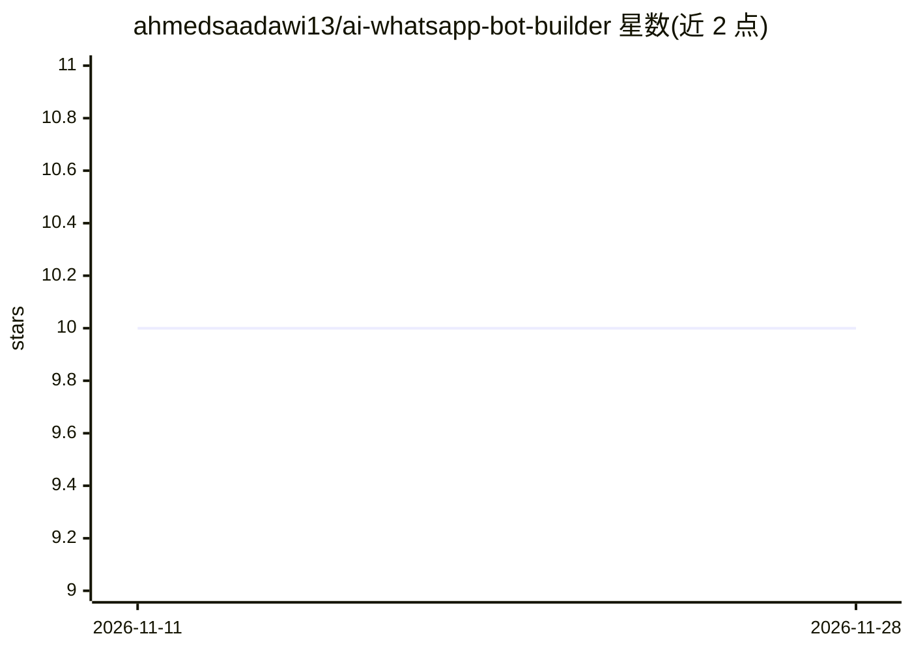

# ahmedsaadawi13/ai-whatsapp-bot-builder

⭐ 10 · PHP · 推送 2026-10-17 · [GitHub](https://github.com/ahmedsaadawi13/ai-whatsapp-bot-builder) · 个人维护

**多租户 SaaS 平台：为商家构建知识库驱动的 WhatsApp AI 客服机器人**

以纯 PHP + MySQL 实现的多租户 SaaS 平台，面向企业与代理机构搭建 WhatsApp 机器人，将结构化流程（触发器/动作/变量/分支、暂停续答）与基于知识库的 AI 问答结合，知识库支持 Q&A 条目与文档上传（TXT/PDF/DOCX）并做全文索引。内置客服坐席收件箱（人工接管使机器人静音）、群发模板、出站 webhook、公共 REST API、订阅计划限额与模拟计费。注意事项：README 声明 WhatsApp 通道与 AI 引擎均为模拟实现，类可替换为真实集成。

## 筛选速览

| 维度 | 判定 | 备注 |
|---|---|---|
| AI 角色 | `ai-native` | 本体是模型或模型工具 |
| 许可风险 | `none` | — |
| 部署形态 | `None` |  |
| 模型依赖 | — | README 未给出锁定关系 |
| 硬件要求 | — | 无带数字的原话,不猜 |
| 安装摩擦 | `low` | 无编译、无系统依赖或容器化 |
| 成熟度 | — | 结构信号不足 |

## 能力要点

- 可视化流程引擎：关键词/菜单/按钮触发、条件分支、变量占位符、暂停续答
- 知识库：文档上传抽取文本并建立 MySQL FULLTEXT 索引，带语气与长度控制及 AI 回退
- 坐席收件箱支持人工接管，接管后机器人自动静音
- 多租户隔离（tenant_id 行级作用域）与订阅限额强制（HTTP 429）

## 适用场景

- 为多个客户分别搭建和管理 WhatsApp 客服机器人
- 让机器人基于上传的文档自动回答常见业务问题
- 通过坐席收件箱在自动回复与人工客服之间切换
- 按订阅计划向客户出租机器人服务并统计用量

## 场景标签

`聊天机器人` · 领域:对话与助手

## 证据(README 行号)

> L3: A multi-tenant SaaS platform, in plain PHP and MySQL, for businesses and agencies to build WhatsApp bots that combin
> L19: |**AI & knowledge base**|Q&A entries plus document upload (TXT/PDF/DOCX/DOC, with text extracted and indexed). MySQ
> L8: - WhatsApp providers and the AI engine are **simulated**. Both sit behind small classes you can swap for real integr

## 星数曲线

2026-11-11 10 → 2026-11-28 10（+0）

---
*卡片 v1 · prompt 1.4 · 生成 2026-11-20 · 置信度 mid · 依据 README sha `6dd55a89df4e` · [字段定义](../../DATASET.md)*
