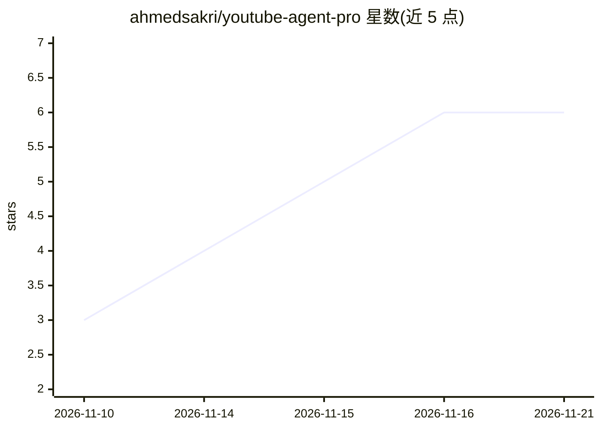

# ahmedsakri/youtube-agent-pro

⭐ 6 · Python · MIT · 推送 2026-10-09 · [GitHub](https://github.com/ahmedsakri/youtube-agent-pro) · [官网](https://github.com/ahmedsakri/youtube-agent-pro) · 个人维护

**给 YouTube 创作者的 Claude Code/ChatGPT/Codex 技能与子代理工具包**

为 YouTube 创作者提供的开源（MIT）工具包：24 个技能工作流（选题、脚本、标题、缩略图、SEO、留存与数据分析等）、5 个 Claude Code 子代理和 11 个本地 Python 工具，可安装在 Claude Code（插件或手动复制）、OpenAI Codex（安装脚本）与 ChatGPT（指令文件）中运行。技能由 AI 托管方执行指令，Python 工具在本地对用户提供的数据做打分与计算，无网络请求、无需 API key。仅产出草稿、计划与分析，不含上传、排期或账号连接功能。

## 筛选速览

| 维度 | 判定 | 备注 |
|---|---|---|
| AI 角色 | `ai-ecosystem` | LLM/agent 周边工具 |
| 许可风险 | `permissive` | MIT |
| 部署形态 | `library` | 以包/库形式分发 |
| 模型依赖 | — | README 未给出锁定关系 |
| 硬件要求 | — | 无带数字的原话,不猜 |
| 安装摩擦 | `low` | 无编译、无系统依赖或容器化 |
| 成熟度 | — | 结构信号不足 |

## 能力要点

- 24 个 YouTube 创作工作流技能，支持 Claude Code、ChatGPT、Codex 三种宿主
- 5 个 Claude Code 子代理按职能（制作/策略/打包/分析/剪辑）编排技能
- 11 个本地 Python 工具做打分与留存分析，无网络请求
- 插件市场安装与本地技能复制两种安装路径

## 适用场景

- 在 Claude Code 里让子代理把一个想法做成完整的视频发布包
- 用本地脚本给标题和缩略图文案打分再定稿
- 分析自己的 YouTube Analytics 导出数据找出留存问题

## 场景标签

`数据分析` `AI 写作` · 领域:效率与自动化

## 证据(README 行号)

> L17: **One repository. 24 YouTube creator workflows per edition, 5 specialist Claude Code subagents, and 11 local Python
> L21: Claude Code (skills **and** subagents), ChatGPT or OpenAI Codex. Delegate a whole video to an agent,
> L146: Three layers: you talk to an **agent** (or call a **skill** directly); skills carry the instructions;

## 星数曲线

2026-11-10 3 → 2026-11-21 6（+3）

---
*卡片 v1 · prompt 1.4 · 生成 2026-11-20 · 置信度 mid · 依据 README sha `8b913bdb32ae` · [字段定义](../../DATASET.md)*
