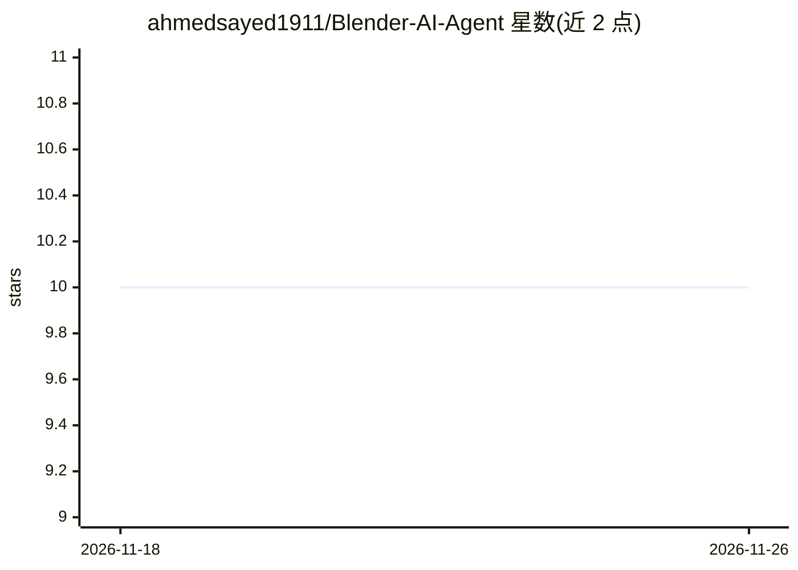

# ahmedsayed1911/Blender-AI-Agent

⭐ 10 · Python · GPL-3.0 · 推送 2026-08-20 · [GitHub](https://github.com/ahmedsayed1911/Blender-AI-Agent) · 个人维护

**本地优先的 LLM→Blender 3D 生成管线：安全工具边界+视觉审查**

将 LLM 规划、Blender 生成、视觉审查、语义运动与工件导出串联为本地端到端管线，通过 MCP 作为 AI 层与 Blender 之间的工具边界，运行时不暴露任意 bpy 或 Python 执行，仅允许白名单化、经校验的工具，并带确认与回滚机制。视觉审查环节只读，使用 Qwen-VL；导出支持预览、GLB 与 H.264 MP4。后端为 FastAPI，前端为 React + Three.js Web Studio。README 自述为实验性系统，Windows 是测试最充分的环境，模型权重需经 Ollama 本地拉取。

## 筛选速览

| 维度 | 判定 | 备注 |
|---|---|---|
| AI 角色 | `ai-native` | 本体是模型或模型工具 |
| 许可风险 | `viral` | GPL-3.0 |
| 部署形态 | `desktop` | 安装包/桌面程序 |
| 模型依赖 | local-ok | 支持本地模型 |
| 硬件要求 | — | 无带数字的原话,不猜 |
| 安装摩擦 | `medium` | 含编译或系统依赖之一 |
| 成熟度 | `idea` | |

## 能力要点

- MCP 工具边界：白名单工具+校验+确认+回滚，不暴露任意 bpy/Python 执行
- Prompt 驱动语义 3D 生成，覆盖生物、机器人、载具、道具、建筑流程
- Qwen-VL 只读视觉审查与语义关节/运动规划
- GLB 与 H.264 MP4 工件导出，FastAPI + React/Three.js Web Studio

## 适用场景

- 用自然语言提示驱动本地 Blender 生成 3D 场景与工件
- 为生物/机器人/载具等对象生成带语义运动的演示动画
- 在本地环境运行 AI→Blender→视觉审查→导出的完整工作流

## 场景标签

 · 领域:3D 内容生成/创作工具

## 证据(README 行号)

> L3: A local, safety-oriented AI-to-3D pipeline that connects LLM planning, Blender generation, visual review, semantic m
> L5: The project uses **MCP (Model Context Protocol)** as the tool boundary between the AI layer and Blender. The model d
> L30: > This is an experimental procedural 3D system, not a production sculpting or game-asset pipeline. Geometry and loc

## 星数曲线

2026-11-18 10 → 2026-11-26 10（+0）

---
*卡片 v1 · prompt 1.4 · 生成 2026-11-20 · 置信度 high · 依据 README sha `f4cde4e3017f` · [字段定义](../../DATASET.md)*
