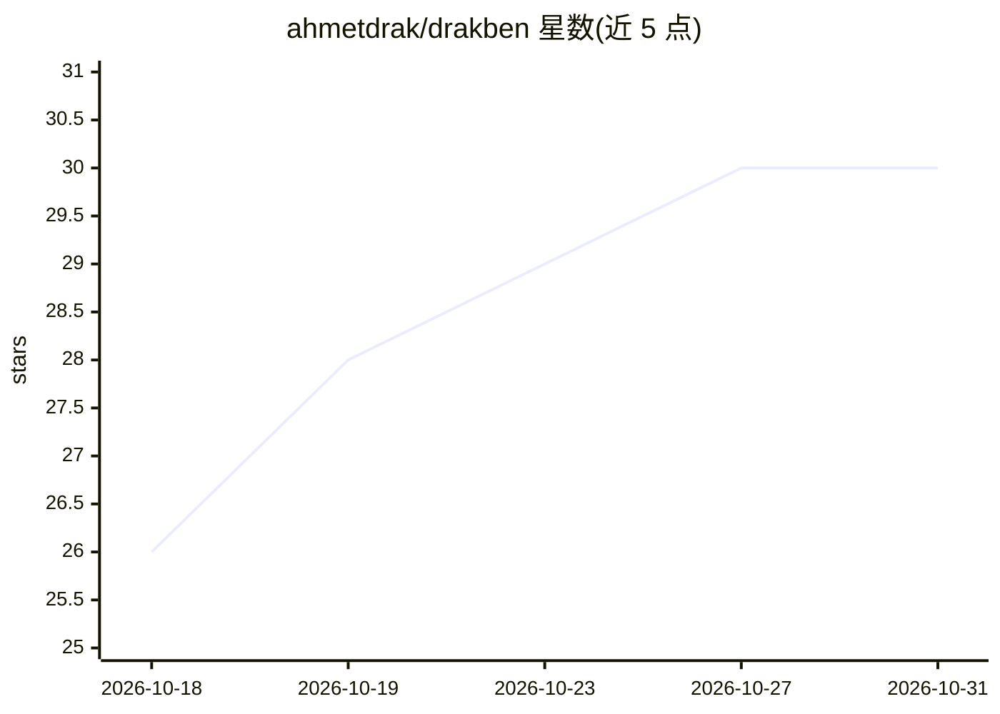

# ahmetdrak/drakben

⭐ 30 · Python · NOASSERTION · 推送 2026-02-16 · [GitHub](https://github.com/ahmetdrak/drakben) · 个人维护

**自然语言驱动的自主渗透测试框架，覆盖侦察到报告全流程**

用 Python 编写的 AI 驱动自主渗透测试框架：以自然语言（土耳其语/英语双语）下达指令，自动执行从侦察、漏洞利用、域渗透到生成报告的完整安全评估流程。核心机制包括多 LLM 支持（OpenRouter/Ollama/OpenAI/自定义）、图记忆与 ChromaDB 向量存储、SQLite 持久化的自我进化引擎、WAF 绕过与载荷生成模块、Docker 沙箱隔离执行及 FastAPI Web API。提供 Docker 与手动安装两种方式，AI 功能需配置 LLM provider，可回退到规则离线模式。

## 筛选速览

| 维度 | 判定 | 备注 |
|---|---|---|
| AI 角色 | `ai-native` | 本体是模型或模型工具 |
| 许可风险 | `permissive` | NOASSERTION |
| 部署形态 | `self-host` | docker 或自建部署 |
| 模型依赖 | local-ok | 支持本地模型 |
| 硬件要求 | — | 无带数字的原话,不猜 |
| 安装摩擦 | `low` | 无编译、无系统依赖或容器化 |
| 成熟度 | — | 结构信号不足 |

## 能力要点

- 自然语言接口（TR/EN 双语）驱动 104 个核心模块与 38 个攻击模块
- 多 LLM 支持：OpenRouter、Ollama（本地）、OpenAI、自定义 API
- SQLite 持久化的自我进化引擎与多态变异载荷
- Docker 沙箱隔离执行，无 Docker 时可原生模式运行

## 适用场景

- 用自然语言描述目标，让框架自动完成端口扫描与漏洞检测
- 安全团队生成 HTML/Markdown/JSON/PDF 格式的渗透测试报告
- 在本地 Ollama 模型上离线执行 AI 驱动的安全评估

## 场景标签

`网络安全` `Agent 框架` · 领域:Agent 开发

## 证据(README 行号)

> L17: DRAKBEN is an **AI-powered autonomous penetration testing framework** built in Python. It understands natural langu
> L31: |Decision Making|Manual|AI-driven autonomous|

## 星数曲线

2026-10-18 26 → 2026-10-31 30（+4）

---
*卡片 v1 · prompt 1.4 · 生成 2026-10-26 · 置信度 mid · 依据 README sha `a391889f07a2` · [字段定义](../../DATASET.md)*
