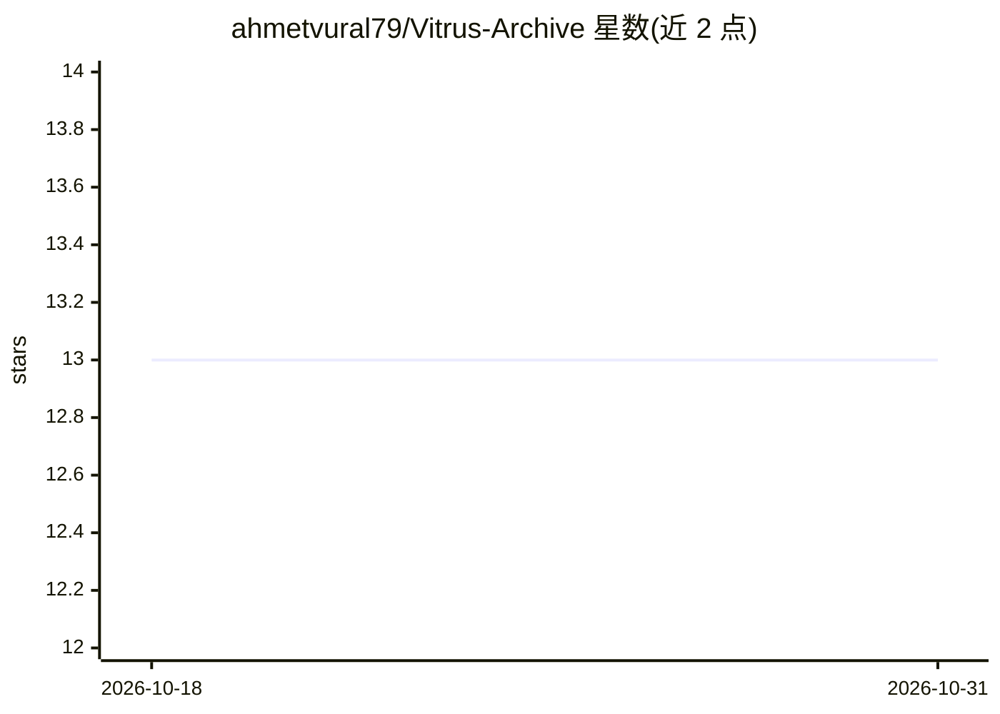

# ahmetvural79/Vitrus-Archive

⭐ 13 · TypeScript · Apache-2.0 · 推送 2026-07-08 · [GitHub](https://github.com/ahmetvural79/Vitrus-Archive) · [官网](https://vitrus.dev) · 个人维护

**企业知识大脑：带来源引用的问答与确定性缺口分析**

面向企业的组织知识库系统（glass-box company brain）：以 Markdown + 类型化边图为事实源，把 GitHub/Slack/Notion/Jira 等连接器与 Obsidian/Notion/聊天记录导入统一进一个知识图谱。提供混合检索（vector+BM25+实体）、带来源与置信度的合成回答（vitrus think）、以及无 LLM 的确定性缺口分析（missing/contradiction/stale/single-point/uncited 五类）与四态 verify 裁决（grounded/stale/contradicted/unsupported）。通过 30 个 MCP 工具和 Agent Skills 供 Claude、Cursor 等 agent 共享同一权限感知记忆，LLM 为 BYO 自带。Apache-2.0 核心，另有 Vitrus Cloud。

## 筛选速览

| 维度 | 判定 | 备注 |
|---|---|---|
| AI 角色 | `ai-ecosystem` | LLM/agent 周边工具 |
| 许可风险 | `permissive` | Apache-2.0 |
| 部署形态 | `self-host` | docker 或自建部署 |
| 模型依赖 | local-ok | 支持本地模型 |
| 硬件要求 | — | 无带数字的原话,不猜 |
| 安装摩擦 | `low` | 无编译、无系统依赖或容器化 |
| 成熟度 | — | 结构信号不足 |

## 能力要点

- 确定性缺口分析（五类）与四态 verify 裁决，gap 检测器不含 LLM
- 混合检索 RRF 融合 + 图信号重排序 + ACL fail-closed
- 七个一级连接器（GitHub/Slack/Notion/Linear/Jira/Drive/Gmail）与八个一键 REST 预设
- 30 个 MCP 工具供人类与 agent 共享同一记忆；OpenAPI 导入与调用前确定性校验

## 适用场景

- 把散落在 Slack/GitHub/文档里的公司知识汇成一个可追溯的问答大脑
- 让 Claude/Cursor 等 agent 读写同一份带权限控制的组织记忆
- 发现知识库中未记录、矛盾、过期的内容并主动提醒
- 新员工/新 agent 第一天获得有出处的学习路径

## 场景标签

`Agent 记忆` `知识图谱` `RAG` · 领域:Agent 开发

## 证据(README 行号)

> L25: - 🤖 **30 MCP tools** so Claude, Cursor and your own agents share the exact same trusted, permission-aware memory.
> L74: - **Agent-native.** The same brain serves humans (CLI, dashboard) and agents (MCP, Agent Skills) from
> L176: ### Providers (BYO-LLM)

## 星数曲线

2026-10-18 13 → 2026-10-31 13（+0）

---
*卡片 v1 · prompt 1.4 · 生成 2026-10-31 · 置信度 high · 依据 README sha `65e16807be1c` · [字段定义](../../DATASET.md)*
