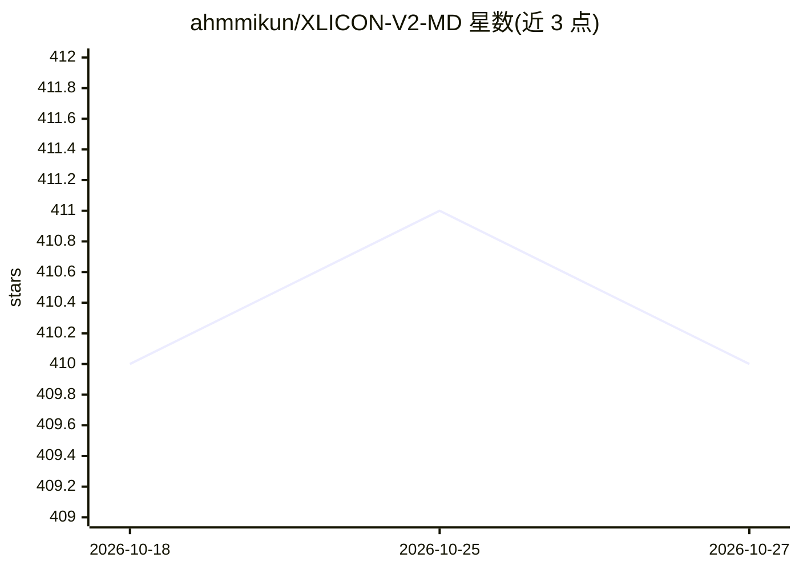

# ahmmikun/XLICON-V2-MD

⭐ 410 · JavaScript · MIT · 推送 2026-10-24 · [GitHub](https://github.com/ahmmikun/XLICON-V2-MD) · [官网](https://xlicon-v2-web.vercel.app/) · 个人维护

**基于 Baileys 的多设备 WhatsApp 机器人，可部署到云平台**

XLICON-V2-MD 是一个用 Node.js 编写的 WhatsApp 多设备机器人，基于 Baileys 库（WhiskeySockets/adiwajshing）实现消息协议连接，由 Salman Ahmad 与 Abraham Dwamena 开发维护。README 未具体列出功能清单（标注为 FEATURES UPDATING），仅描述其为多用途机器人。安装方式为 fork 仓库、获取 Session ID 后通过 Koyeb 等平台或面板 zip 下载部署，主题标签含 ai 但 README 可见内容中无 AI 功能描述。

## 筛选速览

| 维度 | 判定 | 备注 |
|---|---|---|
| AI 角色 | `ai-enhanced` | 去掉 AI 部分产品仍成立 |
| 许可风险 | `permissive` | MIT |
| 部署形态 | `None` |  |
| 模型依赖 | — | README 未给出锁定关系 |
| 硬件要求 | — | 无带数字的原话,不猜 |
| 安装摩擦 | `low` | 无编译、无系统依赖或容器化 |
| 成熟度 | — | 结构信号不足 |

## 能力要点

- 基于 Baileys 的 WhatsApp 多设备机器人
- 支持通过 Koyeb 平台一键部署
- 通过 fork 仓库并获取 Session ID 完成安装

## 适用场景

- 在 WhatsApp 上运行多设备消息机器人
- 部署到 Koyeb 等云平台长期运行

## 场景标签

`聊天机器人` · 领域:对话与助手

## 证据(README 行号)

> L11: XLICON-V2 is a versatile Multi-Device WhatsApp bot built by abztech. founded by Salman It offers a wide range of fe
> L61:  <button id="boton" type="button">Baileys - By WhiskeySockets & adiwajshing</button>

## 星数曲线

2026-10-18 410 → 2026-10-27 410（+0）

---
*卡片 v1 · prompt 1.4 · 生成 2026-10-21 · 置信度 low · 依据 README sha `32f64ccd2ceb` · [字段定义](../../DATASET.md)*
