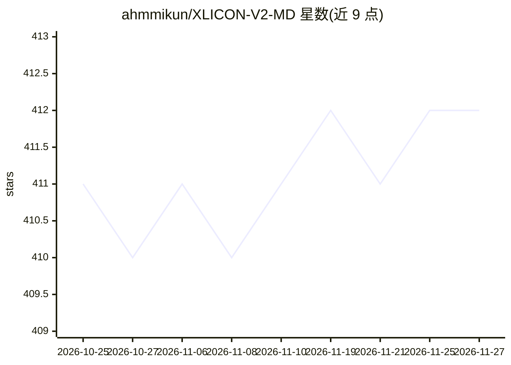

# ahmmikun/XLICON-V2-MD

⭐ 412 · JavaScript · MIT · 推送 2026-11-22 · [GitHub](https://github.com/ahmmikun/XLICON-V2-MD) · [官网](https://xlicon-v2-web.vercel.app/) · 组织维护

**多设备 WhatsApp 机器人，提供多样功能**

XLICON-V2 是一个基于 Baileys 库构建的多设备 WhatsApp 机器人，由 Salman Ahmad 与 Abraham Dwamena 等开发者维护。README 介绍其为功能丰富的通用型机器人，部署方式包括 Fork 仓库后获取 Session ID、下载 zip 部署到面板（Panel），以及通过 Koyeb 平台部署（需配置环境变量）。仓库另含统计徽章、贡献者致谢与支持群组/频道链接。功能列表一节标注为 FEATURES UPDATING，未展开具体功能。

## 筛选速览

| 维度 | 判定 | 备注 |
|---|---|---|
| AI 角色 | `ai-native` | 本体是模型或模型工具 |
| 许可风险 | `permissive` | MIT |
| 部署形态 | `None` |  |
| 模型依赖 | — | README 未给出锁定关系 |
| 硬件要求 | — | 无带数字的原话,不猜 |
| 安装摩擦 | `low` | 无编译、无系统依赖或容器化 |
| 成熟度 | — | 结构信号不足 |

## 能力要点

- 基于 Baileys 库的多设备 WhatsApp 机器人
- 支持 Fork 仓库并获取 Session ID 的部署流程
- 支持 Koyeb 平台部署并配置变量
- 支持面板方式部署（下载 zip）

## 适用场景

- 在 WhatsApp 上运行一个多设备机器人
- 通过 Koyeb 或面板快速部署自己的机器人实例

## 场景标签

`聊天机器人` · 领域:对话与助手

## 证据(README 行号)

> L11: XLICON-V2 is a versatile Multi-Device WhatsApp bot built by abztech. founded by Salman It offers a wide range of fe
> L61:  <button id="boton" type="button">Baileys - By WhiskeySockets & adiwajshing</button>

## 星数曲线

2026-10-25 411 → 2026-11-27 412（+1）

---
*卡片 v1 · prompt 1.4 · 生成 2026-11-25 · 置信度 low · 依据 README sha `2050d95687dc` · [字段定义](../../DATASET.md)*
