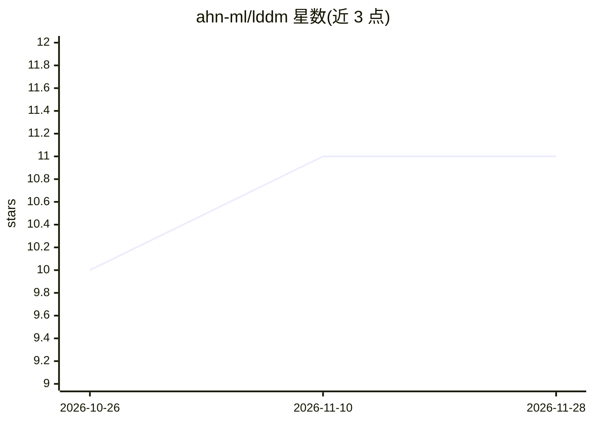

# ahn-ml/lddm

⭐ 11 · Python · Apache-2.0 · 推送 2026-08-10 · [GitHub](https://github.com/ahn-ml/lddm) · [官网](https://sites.google.com/view/lddms/home) · 组织维护

**离散扩散语言模型 LDDM 的官方 PyTorch 实现**

ICLR 2026 论文《Loopholing Discrete Diffusion》的官方 PyTorch 代码库，实现离散扩散语言模型中的确定性潜在传播（loopholing）：在去噪步骤间保留采样前的分布信息，以自条件化目标训练。代码组织为 MDLM/UDLM 基础上的 LDDM_M/LDDM_U 变体，并附 SEDD、D3PM、AR 等基线实现；提供 LM1B 与 OpenWebText 的训练脚本、困惑度/生成/下游任务评估脚本，预训练权重托管于 Google Drive。

## 筛选速览

| 维度 | 判定 | 备注 |
|---|---|---|
| AI 角色 | `ai-native` | 本体是模型或模型工具 |
| 许可风险 | `permissive` | Apache-2.0 |
| 部署形态 | `library` | 以包/库形式分发 |
| 模型依赖 | — | README 未给出锁定关系 |
| 硬件要求 | — | 无带数字的原话,不猜 |
| 安装摩擦 | `medium` | 含编译或系统依赖之一 |
| 成熟度 | — | 结构信号不足 |

## 能力要点

- LDDM_M（masked diffusion）与 LDDM_U（uniform diffusion）两种变体实现
- 自条件化目标训练潜在通路，无需轨迹展开
- 内置 SEDD、D3PM、AR、MDLM、UDLM 基线训练与评估脚本
- 覆盖困惑度、生成与下游任务三类评估

## 适用场景

- 复现论文中的离散扩散语言模型训练与评估
- 在 LM1B/OpenWebText 上训练扩散式文本生成模型
- 运行 SEDD/D3PM/AR 等基线做对比实验

## 场景标签

`模型训练` `模型评测` · 领域:评测与运维

## 证据(README 行号)

> L5: This repository provides the official PyTorch implementation for **Loopholing Discrete Diffusion: Deterministic Bypa
> L7: **Loopholing is deterministic latent propagation for discrete diffusion language models.**
> L10: By preserving this richer latent information, LDDMs stabilize denoising, reduce idle steps and oscillations, and im

## 星数曲线

2026-10-26 10 → 2026-11-28 11（+1）

---
*卡片 v1 · prompt 1.4 · 生成 2026-11-18 · 置信度 high · 依据 README sha `ee7d5d4c4e0b` · [字段定义](../../DATASET.md)*
