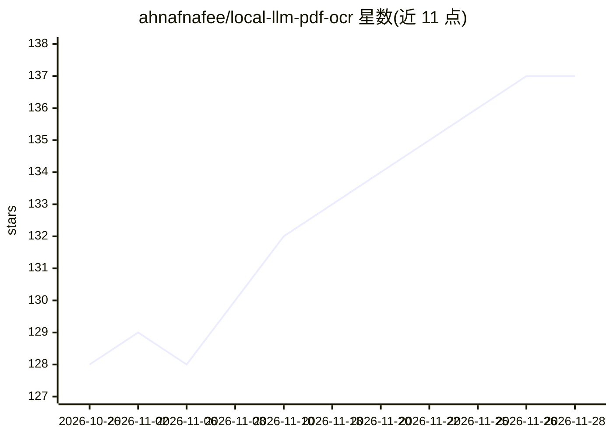

# ahnafnafee/local-llm-pdf-ocr

⭐ 137 · Python · MIT · 推送 2026-10-24 · [GitHub](https://github.com/ahnafnafee/local-llm-pdf-ocr) · [官网](https://www.ahnafnafee.dev/blog/local-llm-pdf-ocr) · 个人维护

**本地视觉 LLM 将扫描 PDF/图片转为可搜索文档（Web UI/CLI）**

Python 编写的 OCR 工具，通过任意 OpenAI 兼容视觉服务接口对扫描 PDF 与图片做转录，在原页面图上叠加可选中文本层，输出可搜索 PDF、HTML 覆盖层、Markdown 或纯文本。提供三条执行路径：默认混合路径（Surya 版面检测 + 本地 LLM 整页转录 + Needleman-Wunsch 动态规划对齐，低置信框做裁剪重识别回退）、可选 grounded 路径（模型直接返回文本与坐标）、纯文本快速路径。支持 .env 与 CLI/UI 参数配置端点与模型，Surya 首次运行从 Hugging Face 下载约 500MB 检测模型。

## 筛选速览

| 维度 | 判定 | 备注 |
|---|---|---|
| AI 角色 | `ai-native` | 本体是模型或模型工具 |
| 许可风险 | `permissive` | MIT |
| 部署形态 | `library` | 以包/库形式分发 |
| 模型依赖 | local-ok | 支持本地模型 |
| 硬件要求 | — | 无带数字的原话,不猜 |
| 安装摩擦 | `low` | 无编译、无系统依赖或容器化 |
| 成熟度 | — | 结构信号不足 |

## 能力要点

- 支持 PDF 及 8 种图片格式输入，多帧 TIFF 展开为多页
- 三种 OCR 路径：混合对齐、grounded（文本+坐标）、纯文本快速路径
- 四种输出格式：可搜索 PDF / HTML 覆盖层 / Markdown / 纯文本
- Web UI 与 CLI 暴露同一套完整选项，模型可从服务端自动发现

## 适用场景

- 把扫描版 PDF 转成可全文检索的文档
- 离线环境批量处理含手写或表单的扫描件
- 对密集排版的页面按框切分识别，规避整页幻觉

## 场景标签

`OCR` `文档解析` · 领域:知识与检索

## 证据(README 行号)

> L17: > **Local LLM PDF OCR** uses vision models such as `olmOCR`, `Qwen3-VL`, or `GLM-OCR` to transcribe documents and a
> L27: - **🤝 DP-Based Text↔Box Alignment** — **Surya** detects layout boxes; a **local LLM** transcribes the whole page; a
> L87: 2. **A vision model served through an OpenAI-compatible API**. Choose your server and use the defaults below or con

## 星数曲线

2026-10-26 128 → 2026-11-28 137（+9）

---
*卡片 v1 · prompt 1.4 · 生成 2026-11-28 · 置信度 mid · 依据 README sha `b2304def0186` · [字段定义](../../DATASET.md)*
