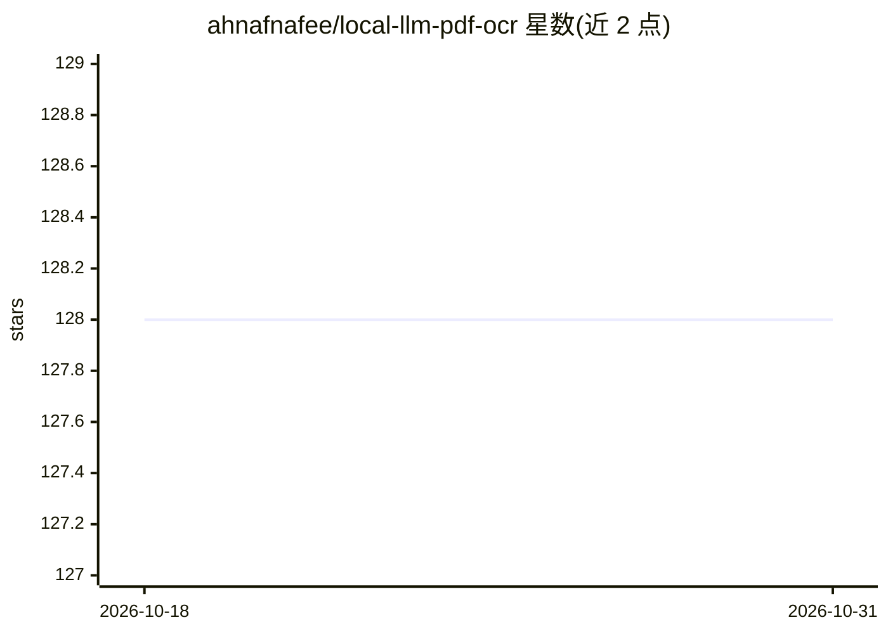

# ahnafnafee/local-llm-pdf-ocr

⭐ 128 · Python · MIT · 推送 2026-10-24 · [GitHub](https://github.com/ahnafnafee/local-llm-pdf-ocr) · [官网](https://www.ahnafnafee.dev/blog/local-llm-pdf-ocr) · 个人维护

**本地视觉 LLM OCR 工具：把扫描 PDF 转成可搜索文档**

面向需要离线、隐私 OCR 的用户：将扫描 PDF 与多种图片格式转为可搜索的三明治 PDF、HTML、Markdown 或纯文本。默认混合路径用 Surya 检测版面布局，本地视觉 LLM（如 olmOCR）整页转录，再用 Needleman–Wunsch 动态规划将文本行对齐到版面框；密集页自动切换逐框 OCR，另有 bbox 原生 VLM 的单次调用路径和纯文本快速路径。通过本地 OpenAI 兼容端点运行模型，提供 Web UI（FastAPI）与全功能 CLI，使用 uv 管理依赖。限制：需自行启动本地 LLM 服务，Surya 模型首次运行约下载 500MB。

## 筛选速览

| 维度 | 判定 | 备注 |
|---|---|---|
| AI 角色 | `ai-native` | 本体是模型或模型工具 |
| 许可风险 | `permissive` | MIT |
| 部署形态 | `library` | 以包/库形式分发 |
| 模型依赖 | local-ok | 支持本地模型 |
| 硬件要求 | — | 无带数字的原话,不猜 |
| 安装摩擦 | `low` | 无编译、无系统依赖或容器化 |
| 成熟度 | — | 结构信号不足 |

## 能力要点

- Surya 布局检测 + 本地 LLM 转录 + Needleman-Wunsch DP 对齐的混合 OCR 路径
- 密集页（>60 框）自动切换逐框 OCR，规避整页 OCR 的循环/幻觉问题
- Grounded 路径：bbox 原生 VLM 单次调用返回文本+坐标，跳过检测与对齐
- 支持 PDF/HTML/Markdown/文本四种输出格式，Web UI 与 CLI 全选项一致

## 适用场景

- 把扫描的纸质文档离线转成可搜索、可选中文字的 PDF
- 在没有云 API 与 API key 的环境下处理含隐私内容的文档 OCR
- 对密集排版或多栏文档批量转录并保留版面位置

## 场景标签

`OCR` `文档解析` · 领域:知识与检索

## 证据(README 行号)

> L5: **Turn scanned PDFs and images into fully searchable, selectable documents — with a local vision LLM.**
> L31: - **🔒 100% Local & Private** — No cloud APIs, no subscription fees. Runs entirely offline via LM Studio, Ollama, vL

## 星数曲线

2026-10-18 128 → 2026-10-31 128（+0）

---
*卡片 v1 · prompt 1.4 · 生成 2026-10-22 · 置信度 mid · 依据 README sha `0d6e03a512c0` · [字段定义](../../DATASET.md)*
