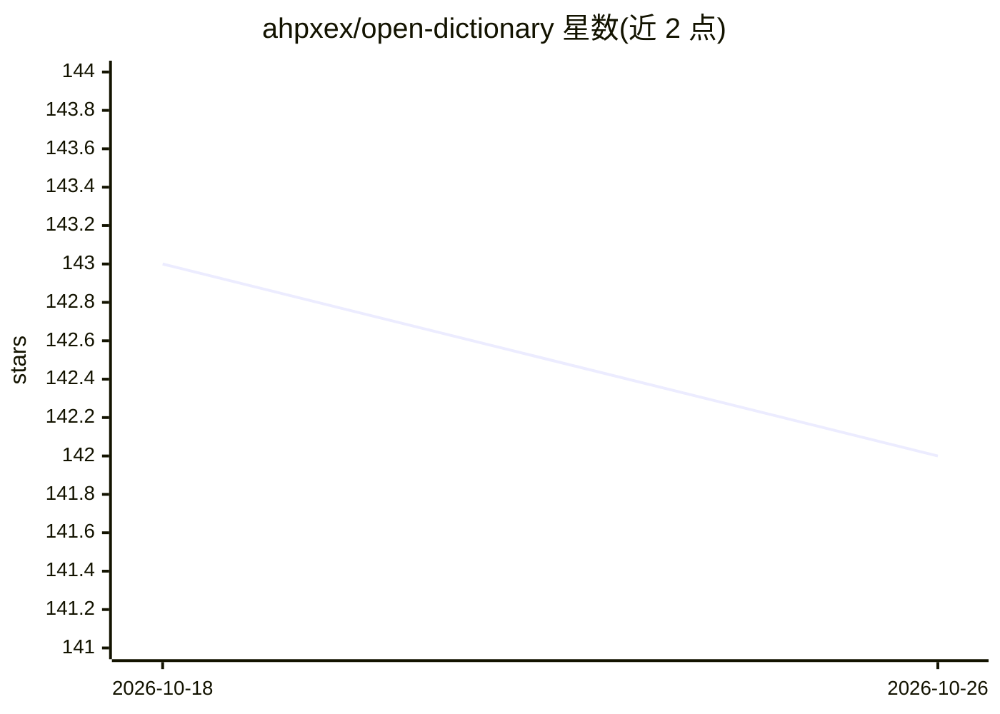

# ahpxex/open-dictionary

⭐ 142 · Python · MIT · 推送 2026-08-10 · [GitHub](https://github.com/ahpxex/open-dictionary) · [官网](https://ahpxex.github.io/open-english-dictionary/) · 个人维护 · 中文 README

**面向语言学习者的开放英语词典及可复现数据管线**

以 Wiktionary/Wiktextract 快照为源，经词频筛选、结构化 LLM 生成与契约校验产出学习者词典数据集：v2.0 简体中文定义语言构建含 84,212 个词条，可从源数据完整重建。定义语言是管线参数，切换参数可构建其他语言版本。生成经由 litellm 走 OpenAI 兼容 provider 池（自动负载均衡与故障冷却），支持断点续跑与版本优先导出；质量体系含生成时硬校验、启发式审计与 LLM 裁判评审三层。工件以 jsonl/SQLite/审计三形式发布（附 SHA256），配套独立桌面客户端 Aictionary。代码 MIT。

## 筛选速览

| 维度 | 判定 | 备注 |
|---|---|---|
| AI 角色 | `ai-knowledge` | 知识聚合/清单类 |
| 许可风险 | `permissive` | MIT |
| 部署形态 | `None` |  |
| 模型依赖 | — | README 未给出锁定关系 |
| 硬件要求 | — | 无带数字的原话,不猜 |
| 安装摩擦 | `low` | 无编译、无系统依赖或容器化 |
| 成熟度 | — | 结构信号不足 |

## 能力要点

- v2.0 发布 84,212 个词条，全链路带运行血缘可从源数据重建
- 定义语言参数化，切换参数即可构建其他语言的学习者释义
- OpenAI 兼容 provider 池：多端点负载均衡、限速加权路由与故障冷却
- 三层质量体系：生成时硬校验、启发式审计、LLM 裁判分层抽样评审

## 适用场景

- 语言学习者通过客户端或 SQLite 离线查询英汉学习词典
- 研究者审计或复现 LLM 生成的词典数据集构建过程
- 自行构建其他定义语言版本的词典数据

## 场景标签

 · 领域:语言学习/词典数据

## 证据(README 行号)

> L10: （简体中文定义语言构建）：**84,212 个词条**，从 Wiktionary/Wiktextract 快照
> L11: 出发，经词频筛选、结构化 LLM 生成与契约校验后产出，全链路带运行血缘，可从
> L64: - **provider 池**：`LLM_PROVIDERS` JSON 数组配置多个 OpenAI 兼容端点，自动负载

## 星数曲线

2026-10-18 143 → 2026-10-26 142（-1）

---
*卡片 v1 · prompt 1.4 · 生成 2026-10-22 · 置信度 high · 依据 README sha `d45a79024ac9` · [字段定义](../../DATASET.md)*
