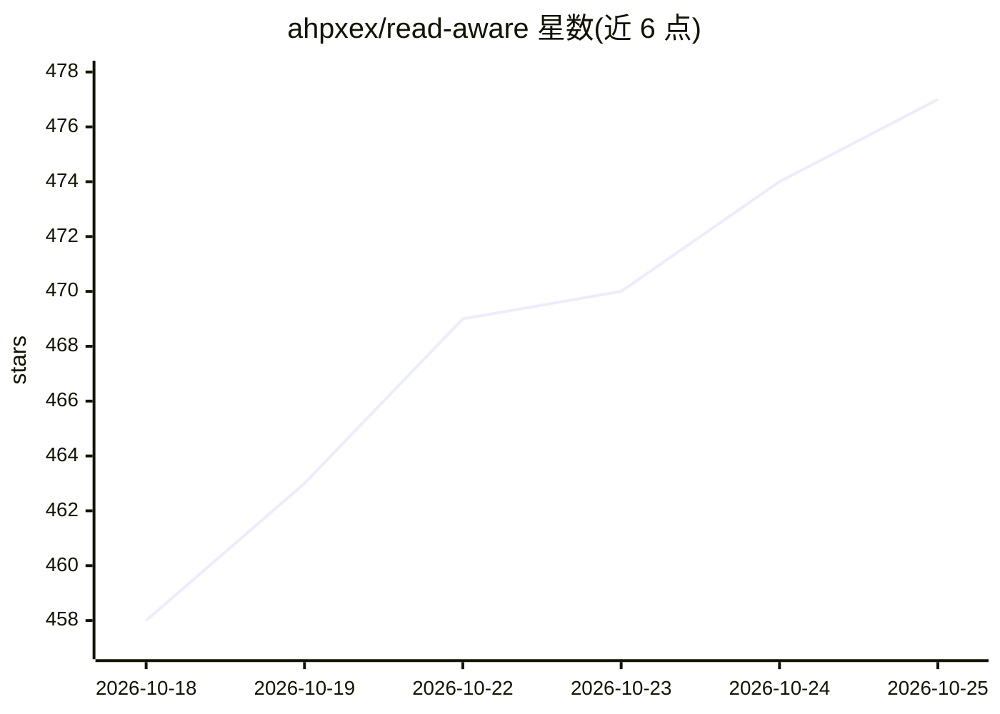

# ahpxex/read-aware

⭐ 476 · TypeScript · AGPL-3.0 · 推送 2026-10-23 · [GitHub](https://github.com/ahpxex/read-aware) · [官网](https://readaware.app) · 个人维护 · 中文 README

**带自进化 AI agent 的跨平台电子书阅读器**

面向读者的免费开源电子书阅读器，覆盖 macOS、Windows、Linux、Android 与 iOS（TestFlight）。核心是单一 agent：编排检索、上下文组装、工具调用与跨书记忆，可在阅读中对话、查词；本地优先，支持离线使用，明确说明可完全不用 AI。支持 EPUB/MOBI/AZW3/FB2/PDF 等 9 种格式，内置沙箱化插件市场（朗读、词典、主题、RSS、WebDAV 同步等）。跨设备同步走 ReadAware 中继或自建 WebDAV，端到端加密。检索基于 SQLite FTS，不依赖向量数据库。AGPL-3.0 许可。

## 筛选速览

| 维度 | 判定 | 备注 |
|---|---|---|
| AI 角色 | `ai-enhanced` | 去掉 AI 部分产品仍成立 |
| 许可风险 | `viral` | AGPL-3.0 |
| 部署形态 | `None` |  |
| 模型依赖 | — | README 未给出锁定关系 |
| 硬件要求 | — | 无带数字的原话,不猜 |
| 安装摩擦 | `low` | 无编译、无系统依赖或容器化 |
| 成熟度 | — | 结构信号不足 |

## 能力要点

- 单一 agent 编排检索、上下文、工具与跨书记忆
- 沙箱化插件系统同时扩展阅读器与 agent（内置市场）
- EPUB/MOBI/AZW3/FB2/PDF/TXT/HTML/CBZ/CBR 九种格式统一标注与进度模型
- 端到端加密同步（ReadAware 中继或自建 WebDAV），本地优先可离线

## 适用场景

- 跨设备阅读电子书并同步笔记、进度与 AI 记忆
- 阅读时直接与 AI 讨论段落、查词并标注生词
- 通过插件市场扩展朗读、词典、RSS 等功能

## 场景标签

`知识库管理` `文档问答` · 领域:知识与检索

## 证据(README 行号)

> L6:  the agent alike. Underneath is a quiet, carefully made reader for EPUB,
> L23: ReadAware is a free and open-source reader for macOS, Windows, Linux, Android,
> L105: ReadAware remains local-first: reading and writing notes work offline, changes

## 星数曲线

2026-10-18 458 → 2026-10-25 477（+19）

---
*卡片 v1 · prompt 1.4 · 生成 2026-10-21 · 置信度 high · 依据 README sha `f94949251467` · [字段定义](../../DATASET.md)*
