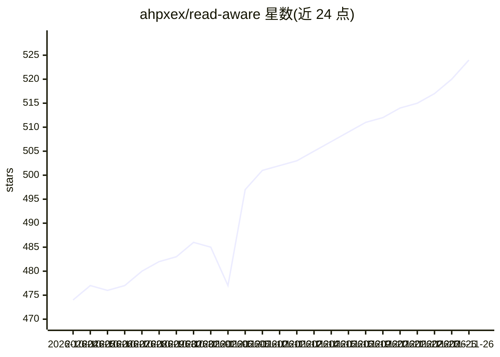

# ahpxex/read-aware

⭐ 524 · TypeScript · AGPL-3.0 · 推送 2026-11-22 · [GitHub](https://github.com/ahpxex/read-aware) · [官网](https://readaware.app) · 个人维护 · 中文 README

**带自进化 AI 阅读代理的跨平台电子书阅读器**

面向 macOS、Windows、Linux、Android 和 iOS 的开源电子书阅读器，支持 EPUB、MOBI、AZW3、FB2、PDF 等格式并可完全离线使用。核心机制为单一本地代理编排检索、上下文组装、工具使用与记忆更新，记忆由跨书的阅读轨迹构建；沙箱化插件系统与代理共用同一领域 API 层，可从内扩展阅读器与代理。数据本地优先，同步经端到端加密，可选 ReadAware 中继或自托管 WebDAV。发布渠道提供各平台安装包，iOS 走 TestFlight。

## 筛选速览

| 维度 | 判定 | 备注 |
|---|---|---|
| AI 角色 | `ai-enhanced` | 去掉 AI 部分产品仍成立 |
| 许可风险 | `viral` | AGPL-3.0 |
| 部署形态 | `None` |  |
| 模型依赖 | — | README 未给出锁定关系 |
| 硬件要求 | — | 无带数字的原话,不猜 |
| 安装摩擦 | `low` | 无编译、无系统依赖或容器化 |
| 成熟度 | — | 结构信号不足 |

## 能力要点

- 单一代理编排检索、上下文组装、工具使用与记忆更新
- 沙箱插件市场提供 TTS、词典、主题、RSS、WebDAV 同步等插件
- 端到端加密同步，支持 ReadAware 中继或自有 WebDAV 服务器
- 本地优先：SQLite FTS 检索，无需向量数据库

## 适用场景

- 离线阅读 EPUB/MOBI/PDF 并做划线、高亮与笔记
- 针对书中段落向 AI 提问并追踪想法
- 多设备同步书籍进度、标注与阅读记忆
- 安装插件扩展朗读、词典、订阅阅读等功能

## 场景标签

`知识库管理` `文档问答` · 领域:知识与检索

## 证据(README 行号)

> L6:  the agent alike. Underneath is a quiet, carefully made reader for EPUB,
> L23: ReadAware is a free and open-source reader for macOS, Windows, Linux, Android,

## 星数曲线

2026-10-24 474 → 2026-11-26 524（+50）

---
*卡片 v1 · prompt 1.4 · 生成 2026-11-25 · 置信度 high · 依据 README sha `5fdbb08e0347` · [字段定义](../../DATASET.md)*
