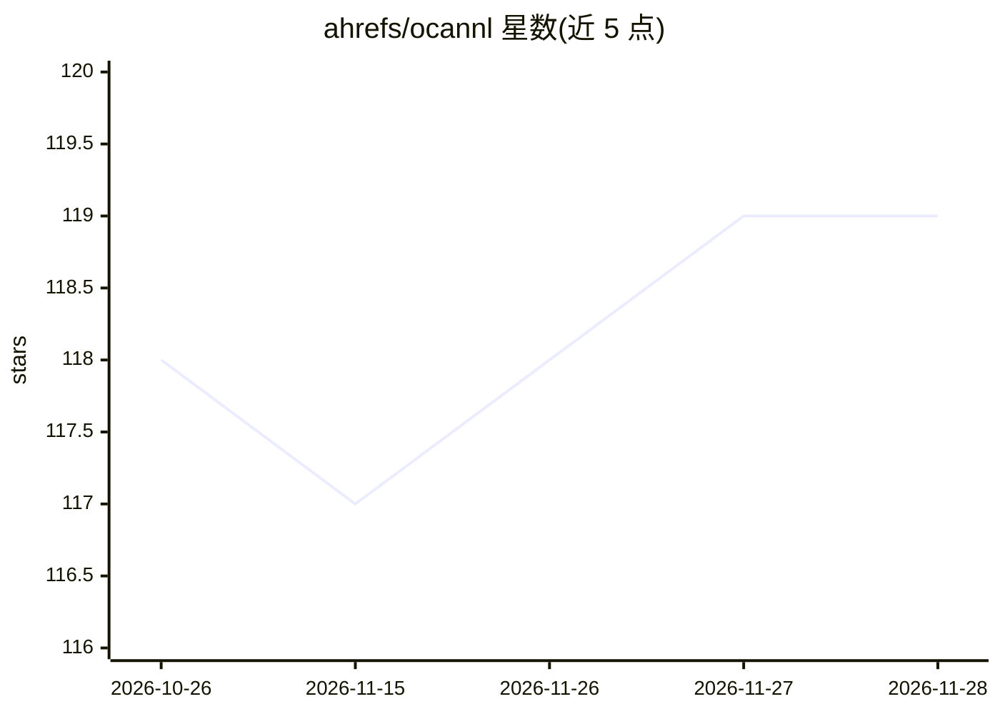

# ahrefs/ocannl

⭐ 119 · OCaml · BSD-2-Clause · 推送 2026-11-27 · [GitHub](https://github.com/ahrefs/ocannl) · [官网](https://ahrefs.github.io/ocannl/docs/) · 组织维护

**OCaml 编译型深度学习框架：自动微分+形状推断+多后端**

从零实现的 OCaml 编译型深度学习框架，实现反向传播（一阶逆向模式自动微分）与形状推断，可将张量计算编译到 for 循环级别，规划 CUDA、Metal、HIP 等多个底层后端。提供扩展的 einsum 记法、混合精度双向精度推断、%op/%cd 两级抽象语法扩展，编译单元范围由用户显式定义。提供 makemore 教程、迁移指南与配置预设（reproducible/performance/approximate）；README 披露其基准结果慢于 torch.compile 与 tinygrad。

## 筛选速览

| 维度 | 判定 | 备注 |
|---|---|---|
| AI 角色 | `ai-ecosystem` | LLM/agent 周边工具 |
| 许可风险 | `permissive` | BSD-2-Clause |
| 部署形态 | `None` |  |
| 模型依赖 | — | README 未给出锁定关系 |
| 硬件要求 | — | 无带数字的原话,不猜 |
| 安装摩擦 | `medium` | 含编译或系统依赖之一 |
| 成熟度 | — | 结构信号不足 |

## 能力要点

- 从零实现的编译式自动微分与形状推断
- 扩展 einsum 记法、静态索引与混合精度推断
- CUDA/Metal/HIP 后端及调试追踪工具
- 含教程、技术报告与端到端编译走查文档

## 适用场景

- 用 OCaml 构建和训练神经网络
- 学习自动微分与形状推断的编译实现
- 在 CUDA/Metal/AMD GPU 上运行张量程序

## 场景标签

 · 领域:机器学习/深度学习框架

## 证据(README 行号)

> L7: * A from-scratch, compiled Deep Learning framework.
> L9: * The long-term goal is to provide several "low-level" backends, aiming to seek inspiration from projects such as ti
> L10:  * OCANNL starts with a high-level representation, but can compile everything down to `for` loops.

## 星数曲线

2026-10-26 118 → 2026-11-28 119（+1）

---
*卡片 v1 · prompt 1.4 · 生成 2026-11-28 · 置信度 high · 依据 README sha `0061f6a017f7` · [字段定义](../../DATASET.md)*
