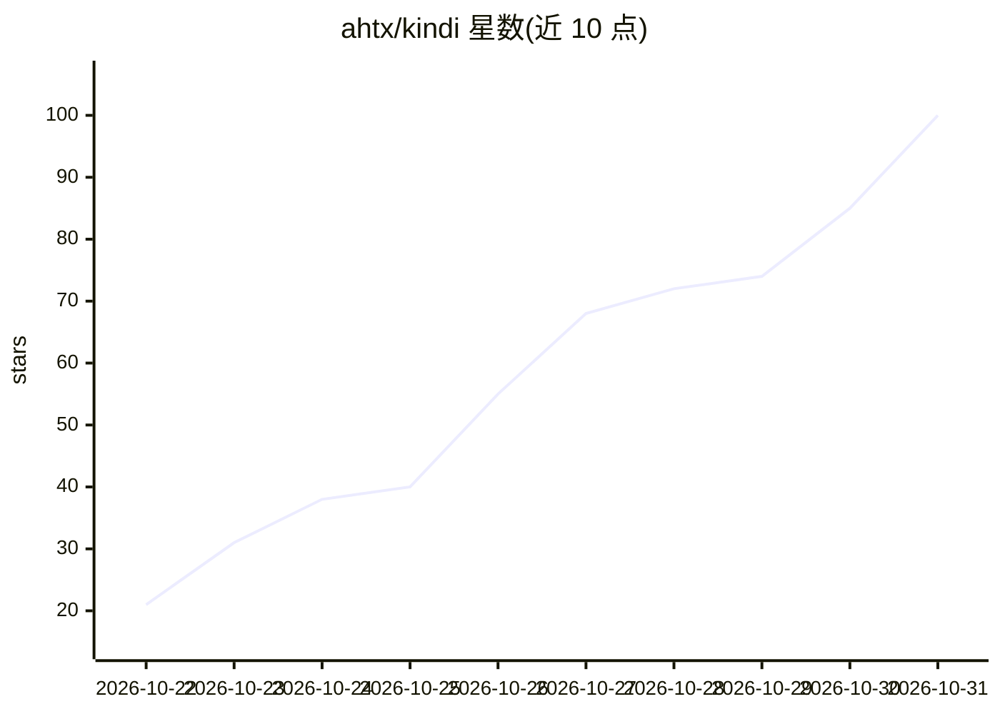

# ahtx/kindi

⭐ 100 · Python · AGPL-3.0 · 推送 2026-10-29 · [GitHub](https://github.com/ahtx/kindi) · [官网](https://amirhusain.com/kindi/) · 个人维护

**面向老旧/低价 NVIDIA 卡的自研 LLM 推理引擎，带 OpenAI 兼容服务**

Kindi 是 Prism ML Ternary-Bonsai-2 系列三值权重模型（2B/4B/9B/27B）的自定义推理引擎，支持 NVIDIA Kepler 到 Ampere 架构显卡（如 1GB Quadro K420、双 K1200 张量并行、GTX 1080、RTX 3080）及 CPU（AVX2）引擎。提供 OpenAI 兼容服务器（chat/completions、tools、流式、thinking），默认输出与 llama.cpp 逐 token 一致，README 给出各卡速度对比。通过一条 curl 安装脚本、Docker 镜像或原生 CUDA 10.2 + Python 环境安装。限制：仅支持 Bonsai 系列模型，Kepler 需 470 系列驱动。

## 筛选速览

| 维度 | 判定 | 备注 |
|---|---|---|
| AI 角色 | `ai-ecosystem` | LLM/agent 周边工具 |
| 许可风险 | `dual` | AGPL-3.0 |
| 部署形态 | `self-host` | docker 或自建部署 |
| 模型依赖 | — | README 未给出锁定关系 |
| 硬件要求 | — | 无带数字的原话,不猜 |
| 安装摩擦 | `low` | 无编译、无系统依赖或容器化 |
| 成熟度 | — | 结构信号不足 |

## 能力要点

- 在 1GB Quadro K420 上运行 2B 模型，README 记录 20-23 tokens/s
- 双 Quadro K1200 张量并行合成一张 8GB 卡运行 27B 模型
- OpenAI 兼容服务器，支持 tools、流式、thinking（reasoning_content）
- 默认输出与 llama.cpp 逐 token 一致（verify 命令校验）

## 适用场景

- 用手里老旧的 Kepler/Maxwell/Pascal 显卡本地跑 LLM
- 为聊天客户端和编码 agent 提供本地 OpenAI 兼容推理端点
- 低成本多卡（双 K1200）张量并行运行 27B 模型

## 场景标签

`推理引擎` · 领域:训练与推理

## 证据(README 行号)

> L9: Kindi is a custom inference engine for Prism ML's **Ternary-Bonsai-2** language models (2B, 4B, 9B and 27B
> L12: the GeForce RTX 3080, a CPU engine and a one-command installer. It has an **OpenAI-compatible server** for chat

## 星数曲线

2026-10-22 21 → 2026-10-31 100（+79）

---
*卡片 v1 · prompt 1.4 · 生成 2026-10-25 · 置信度 mid · 依据 README sha `24d3252928e2` · [字段定义](../../DATASET.md)*
