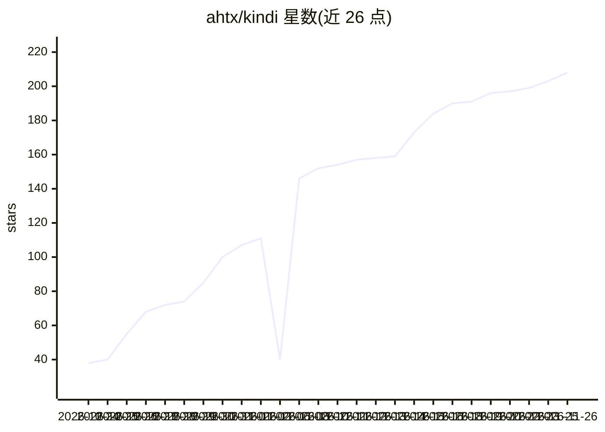

# ahtx/kindi

⭐ 208 · Python · AGPL-3.0 · 推送 2026-11-25 · [GitHub](https://github.com/ahtx/kindi) · [官网](https://amirhusain.com/software/kindi/) · 个人维护

**在低成本 GPU 与 CPU 上本地运行 LLM 的推理引擎**

自研语言模型推理引擎，面向低端 GPU：支持从 1 GB Kepler 卡到 RTX 50 系、CMP 170HX、AMD Radeon 780M/840M/8060S 及 x86-64 AVX2 CPU。运行 Prism ML 三值 Bonsai 系列、AH-Nanbeige4.3-33B、Nemotron 3.5 Lightning、DeepSeek-V4.1-Flash、Qwen3.8-Flash-Next 等模型；提供 OpenAI 兼容服务器、prompt 缓存、工具调用、投机解码与 LoRA 适配器。以 Docker 镜像（CUDA/ROCm）或脚本安装器分发，README 声明与 llama.cpp 输出逐 token 一致，并列出每卡基准数据。AGPL-3.0 许可，另有商业许可。

## 筛选速览

| 维度 | 判定 | 备注 |
|---|---|---|
| AI 角色 | `ai-ecosystem` | LLM/agent 周边工具 |
| 许可风险 | `dual` | AGPL-3.0 |
| 部署形态 | `self-host` | docker 或自建部署 |
| 模型依赖 | — | README 未给出锁定关系 |
| 硬件要求 | — | 无带数字的原话,不猜 |
| 安装摩擦 | `low` | 无编译、无系统依赖或容器化 |
| 成熟度 | — | 结构信号不足 |

## 能力要点

- OpenAI 兼容服务器，支持 prompt 缓存、工具调用与投机解码
- 支持 1 GB Kepler 显卡至 RTX 50 系、AMD RDNA3/3.5 与 AVX2 CPU
- 提供逐卡基准表，声明与 llama.cpp 输出逐 token 一致（kindi verify）
- 支持多请求并发、多卡部署与 LoRA 适配器

## 适用场景

- 在旧款或低显存显卡上本地运行大模型
- 为本地模型提供 OpenAI 兼容 API 给现有聊天客户端
- 用 Bonsai 系列模型在 CPU 上做推理

## 场景标签

`推理引擎` · 领域:训练与推理

## 证据(README 行号)

> L9: Kindi is a custom inference engine for language models on low-cost GPUs. It runs Prism ML's ternary
> L12: supports AMD Radeon 780M, 840M and 8060S graphics, and x86-64 CPUs. The OpenAI-compatible server has a prompt
> L123: |GPU|NVIDIA, compute capability 3.0 (Kepler) or later. Tested: Quadro K420 (1 GB and 2 GB), Quadro K1200 (one card

## 星数曲线

2026-10-24 38 → 2026-11-26 208（+170）

---
*卡片 v1 · prompt 1.4 · 生成 2026-11-26 · 置信度 high · 依据 README sha `49413bb5b95a` · [字段定义](../../DATASET.md)*
