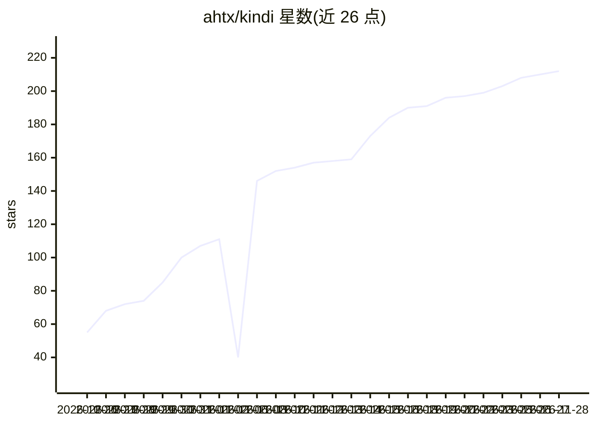

# ahtx/kindi

⭐ 212 · Python · AGPL-3.0 · 推送 2026-11-27 · [GitHub](https://github.com/ahtx/kindi) · [官网](https://amirhusain.com/software/kindi/) · 个人维护

**低成本 GPU/CPU 上的本地 LLM 推理引擎**

Kindi 是一个面向低价 GPU 的自研语言模型推理引擎，覆盖从 1 GB 显存的 Quadro K420 到 RTX 50 系列、CMP 170HX、AMD Radeon 780M/840M/8060S 及 x86-64 CPU。支持 Bonsai 系列、AH-Nanbeige4.3-33B、Nemotron 3.5 Lightning、DeepSeek-V4.1-Flash、Qwen3.8-Flash-Next 等模型，提供 OpenAI 兼容服务器、prompt 缓存、工具调用、思考模式与投机解码。通过安装脚本或 Docker 镜像分发，AGPL-3.0 许可并提供商业许可。

## 筛选速览

| 维度 | 判定 | 备注 |
|---|---|---|
| AI 角色 | `ai-ecosystem` | LLM/agent 周边工具 |
| 许可风险 | `dual` | AGPL-3.0 |
| 部署形态 | `self-host` | docker 或自建部署 |
| 模型依赖 | — | README 未给出锁定关系 |
| 硬件要求 | — | 无带数字的原话,不猜 |
| 安装摩擦 | `low` | 无编译、无系统依赖或容器化 |
| 成熟度 | — | 结构信号不足 |

## 能力要点

- 支持 Kepler 至 RTX 50 的 NVIDIA 卡、AMD RDNA3/3.5 与 x86-64 AVX2 CPU
- OpenAI 兼容服务器，带 prompt 缓存、工具调用与投机解码（MTP/DSpine/DSpark drafter）
- 提供 Linux/Windows 一键安装脚本，自动检测显卡并下载校验模型
- 提供 Docker 镜像（CUDA/ROCm6/ROCm7）与 docker compose 部署方式

## 适用场景

- 在老旧或低价显卡上本地运行大语言模型
- 为 Open WebUI、LM Studio、Jan 等客户端提供本地 OpenAI 兼容后端
- 在无 GPU 的 x86-64 服务器上用 CPU 路径运行小参数模型

## 场景标签

`推理引擎` · 领域:训练与推理

## 证据(README 行号)

> L9: Kindi is a custom inference engine for language models on low-cost GPUs. It runs Prism ML's ternary
> L13: supports AMD Radeon 780M, 840M and 8060S graphics, and x86-64 CPUs. The OpenAI-compatible server has a prompt
> L147: 3. Connect a chat client. Kindi uses the OpenAI API at `http://localhost:8093/v1`. In Open WebUI, LM Studio, Jan o

## 星数曲线

2026-10-26 55 → 2026-11-28 212（+157）

---
*卡片 v1 · prompt 1.4 · 生成 2026-11-28 · 置信度 mid · 依据 README sha `278f6b5b9ecc` · [字段定义](../../DATASET.md)*
