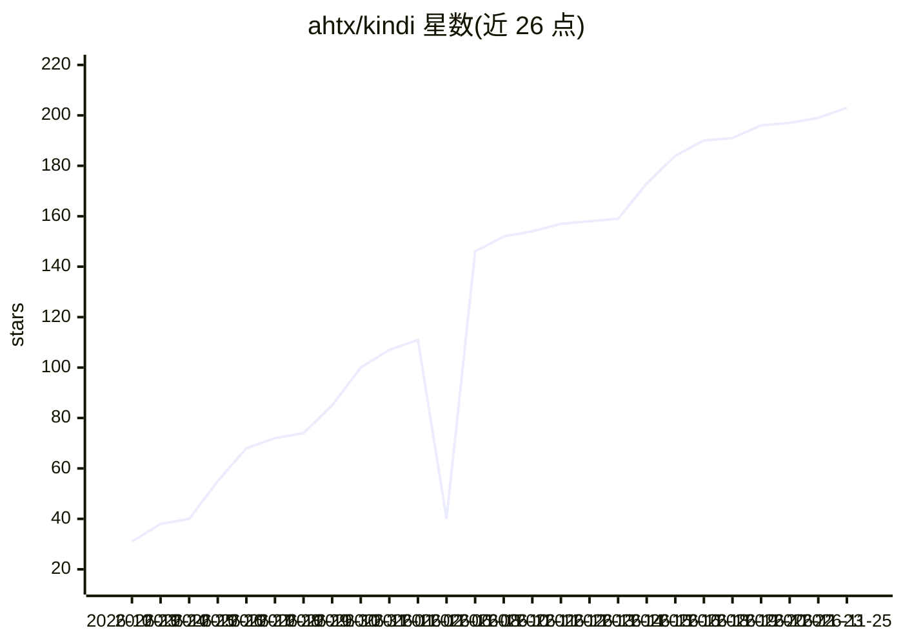

# ahtx/kindi

⭐ 203 · Python · AGPL-3.0 · 推送 2026-11-23 · [GitHub](https://github.com/ahtx/kindi) · [官网](https://amirhusain.com/software/kindi/) · 个人维护

**在低成本 GPU 和 CPU 上本地运行大语言模型的推理引擎**

Kindi 是一个面向低成本 GPU 的自研语言模型推理引擎，支持 NVIDIA Kepler（Quadro K420）到 RTX 50 系列、CMP 170HX、AMD Radeon 780M/840M/8060S 及 x86-64 AVX2 CPU。运行 Ternary Bonsai、AH-Nanbeige4.3、Nemotron Lightning、DeepSeek-V4.1-Flash、Qwen3.8-Flash-Next 等模型，提供 OpenAI 兼容服务器（带 prompt 缓存、工具调用、思考模式、投机解码）。以一键安装脚本或 Docker 镜像（ghcr.io）分发，AGPL-3.0 许可并另行提供商业许可。README 给出与 llama.cpp 在相同卡片和模型文件上的逐 token 对比测量。

## 筛选速览

| 维度 | 判定 | 备注 |
|---|---|---|
| AI 角色 | `ai-ecosystem` | LLM/agent 周边工具 |
| 许可风险 | `dual` | AGPL-3.0 |
| 部署形态 | `self-host` | docker 或自建部署 |
| 模型依赖 | — | README 未给出锁定关系 |
| 硬件要求 | — | 无带数字的原话,不猜 |
| 安装摩擦 | `low` | 无编译、无系统依赖或容器化 |
| 成熟度 | — | 结构信号不足 |

## 能力要点

- OpenAI 兼容服务器，带 prompt 缓存、工具调用、思考模式与投机解码
- 支持 1 GB 显存的 Kepler 老卡到 RTX 50 系列，另有 AMD RDNA3/RDNA3.5 与 CPU 引擎
- 提供 token 级对齐 llama.cpp 输出的 verify 校验命令
- Windows 安装器自动配置 WSL2 并含托盘监视器

## 适用场景

- 在没有新驱动的老款 Quadro/GeForce 显卡上本地跑大模型
- 用 OpenAI 兼容接口把本地模型接入 Open WebUI、LM Studio、Jan 等客户端
- 在 8 GB 显存的单卡上运行 125B MoE 模型
- 在没有 GPU 的 x86-64 机器上用 CPU 引擎运行小模型

## 场景标签

`推理引擎` · 领域:训练与推理

## 证据(README 行号)

> L9: Kindi is a custom inference engine for language models on low-cost GPUs. It runs Prism ML's ternary
> L12: supports AMD Radeon 780M, 840M and 8060S graphics, and x86-64 CPUs. The OpenAI-compatible server has a prompt
> L96: 3. Connect a chat client. Kindi uses the OpenAI API at `http://localhost:8093/v1`. In Open WebUI, LM Studio, Jan or

## 星数曲线

2026-10-23 31 → 2026-11-25 203（+172）

---
*卡片 v1 · prompt 1.4 · 生成 2026-11-25 · 置信度 high · 依据 README sha `29d57bba765c` · [字段定义](../../DATASET.md)*
