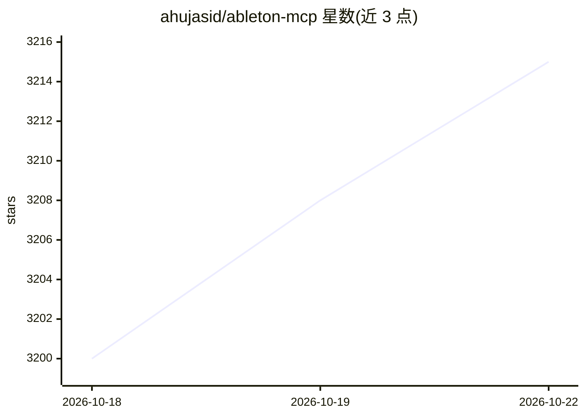

# ahujasid/ableton-mcp

⭐ 3,215 · Python · MIT · 推送 2026-09-22 · [GitHub](https://github.com/ahujasid/ableton-mcp) · 个人维护

**让 LLM 通过 MCP 控制 Ableton Live 做音乐制作的服务器**

由 Ableton Remote Script（在 Live 内创建 socket 服务器执行命令）与 MCP Server（实现 Model Context Protocol）两部分组成，将 Claude、Cursor 等 MCP 客户端连接到 Ableton Live，实现创建/修改 MIDI 与音频轨道、加载乐器与效果器、创建剪辑、编排完整歌曲段落、控制播放与速度等操作。前置条件为 Ableton Live 10+、Python 3.8+、uv；默认开启匿名遥测（可关闭），数据集记录默认关闭需显式开启。

## 筛选速览

| 维度 | 判定 | 备注 |
|---|---|---|
| AI 角色 | `ai-ecosystem` | LLM/agent 周边工具 |
| 许可风险 | `permissive` | MIT |
| 部署形态 | `library` | 以包/库形式分发 |
| 模型依赖 | — | README 未给出锁定关系 |
| 硬件要求 | — | 无带数字的原话,不猜 |
| 安装摩擦 | `low` | 无编译、无系统依赖或容器化 |
| 成熟度 | — | 结构信号不足 |

## 能力要点

- Remote Script + MCP Server 双组件架构，JSON over TCP socket 通信
- 支持创建/修改 MIDI 与音频轨道、加载乐器效果器、完整编曲
- 支持 Claude Desktop、Cursor、Claude Code 三种客户端接入
- 匿名遥测默认开启可关闭；数据集记录默认关闭需 opt-in

## 适用场景

- 用自然语言让 Claude 在 Ableton Live 里创建整首歌曲编曲
- 通过对话加载乐器、效果器并调整轨道与剪辑
- 在 Cursor 或 Claude Code 中远程控制 Live 的播放与会话

## 场景标签

 · 领域:音乐制作/LLM 工具接入

## 证据(README 行号)

> L83: 1. **Ableton Remote Script** (`Ableton_Remote_Script/__init__.py`) — a MIDI Remote Script for Ableton Live that cre
> L84: 2. **MCP Server** (`server.py`) — a Python server that implements the Model Context Protocol and connects to the Ab

## 星数曲线

2026-10-18 3,200 → 2026-10-22 3,215（+15）

---
*卡片 v1 · prompt 1.4 · 生成 2026-10-20 · 置信度 high · 依据 README sha `95e9fef36821` · [字段定义](../../DATASET.md)*
