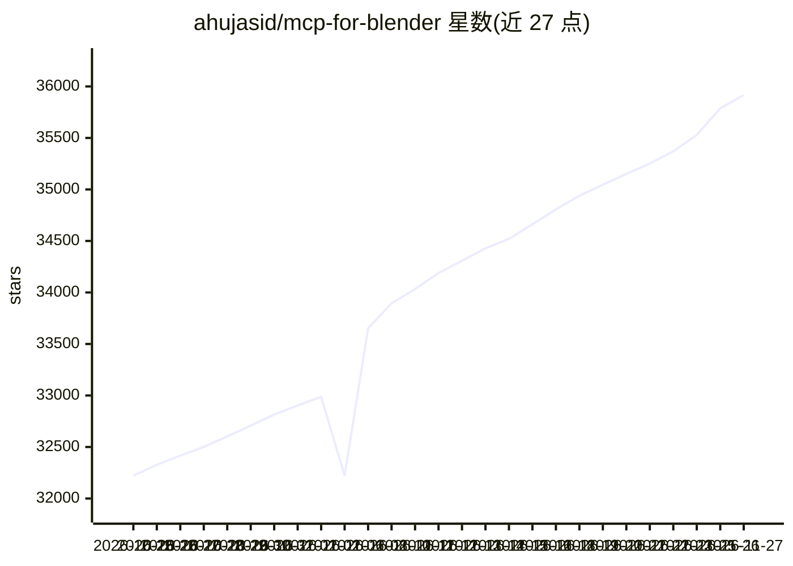

# ahujasid/mcp-for-blender

⭐ 35,916 · Python · MIT · 推送 2026-11-26 · [GitHub](https://github.com/ahujasid/mcp-for-blender) · [官网](https://www.mcp-for-blender.com/) · 个人维护

**让 AI 客户端经 MCP 控制 Blender 3D 建模与场景的插件**

由 Blender 插件（内置 socket 服务器）与实现 Model Context Protocol 的 Python MCP 服务器两部分组成，二者配合使 Claude Desktop、Claude Code、Cursor、VS Code、Codex 等 MCP 客户端能对 Blender 执行对象增删改、材质调整、Python 代码执行与视觉自检。支持 Poly Haven、Sketchfab、Poly Pizza 素材及 Meshy、Tripo、Hyper3D Rodin、Hunyuan3D、World Labs 的 AI 生成模型接入。提供一键安装脚本、uvx 运行、pipx 与 Docker 方式；addon socket 无认证加密，默认任意 Python 可执行，另有 SAFE_MODE 校验选项。

## 筛选速览

| 维度 | 判定 | 备注 |
|---|---|---|
| AI 角色 | `ai-ecosystem` | LLM/agent 周边工具 |
| 许可风险 | `permissive` | MIT |
| 部署形态 | `desktop` | 安装包/桌面程序 |
| 模型依赖 | — | README 未给出锁定关系 |
| 硬件要求 | — | 无带数字的原话,不猜 |
| 安装摩擦 | `low` | 无编译、无系统依赖或容器化 |
| 成熟度 | — | 结构信号不足 |

## 动量与使用信号

- 维护:`active` — 距上次 push 11.7 天,年发版 0,43 位贡献者
- 涨星:近 1 天 **+346**(自 20261016 起算)
- 安装:github 包 `release-assets` 月下载无数据
- 平台:WINDOWS / MACOS / LINUX · 协议:MCP

## 能力要点

- 双向 socket 通信连接 MCP 客户端与 Blender
- AI 直接编写并执行 Blender Python，可多视角渲染自检结果
- 支持 Meshy/Tripo/Hyper3D Rodin/Hunyuan3D/World Labs 生成 3D 模型
- SAFE_MODE 可拦截风险脚本，仅允许常规建模操作

## 适用场景

- 用对话方式创建和修改 Blender 3D 对象与材质
- 自动搭建场景并让 AI 渲染检查自己的成果
- 把 Sketchfab/Poly Haven 素材和 AI 生成的 3D 模型导入 Blender

## 场景标签

`编码 Agent` `GUI 自动化` `多模态` · 领域:效率与自动化

## 证据(README 行号)

> L139: 1. **Blender Addon** (`addon.py`) — a Blender addon that creates a socket server within Blender to receive and exe
> L140: 2. **MCP Server** (`src/blender_mcp/server.py`) — a Python server that implements the Model Context Protocol and c

## 星数曲线

2026-10-25 32,222 → 2026-11-27 35,916（+3,694）

---
*卡片 v1 · prompt 1.4 · 生成 2026-11-22 · 置信度 high · 依据 README sha `fd4bd342e748` · [字段定义](../../DATASET.md)*
